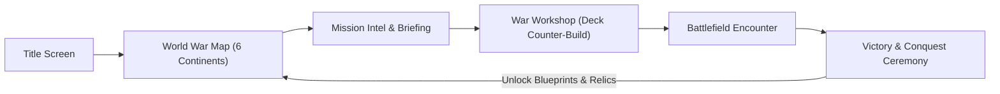
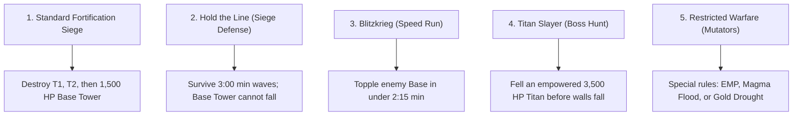

# EPIC BATTLE! — GRAND CONQUEST MODE (GDD & ARCHITECTURE SPECIFICATION)
**Version:** 1.0.0  
**Design Paradigm:** Flow 3 — Story Campaign, Territory Domination & Sequential Unit Blueprint Unlock  
**Target Runtimes:** 2D HTML5 Canvas (`epic_battle_2d`) & 3D Roblox Studio Luau (`epic_battle`)

---

## 1. Executive Summary & Design Vision

**Grand Conquest** transforms *Epic Battle!* from a standalone skirmish arena into a narrative-driven, strategic continent-conquest campaign. 

Instead of having all 54 units unlocked immediately, the player begins as the commander of a single vanguard expedition (starting with 3 basic C-Tier units). By invading and liberating territories across the **6 Faction Continents** of *Geo-Terra*, players:
1. Scout enemy intel and territory traits on an interactive World War Map.
2. Adapt their 6-card Grimoire loadout to counter specific tactical mission modifiers.
3. Overthrow enemy garrisons, survive desperate siege defenses, and hunt colossal Titan bosses.
4. Unlock permanent unit blueprints, cross-faction mercenaries, and empire passive relics.



---

## 2. World Structure: The 6 Continents of Geo-Terra

The campaign is divided into **6 Sequential / Branching Chapters**, each representing the home realm of one of the core factions. Each chapter holds **3 to 4 territories** (total of 20 campaign sectors):

| Chapter | Realm Name | Faction Occupant | Visual Environment | Strategic Theme |
| :--- | :--- | :--- | :--- | :--- |
| **Ch. 1** | **The Sun-Gilded Plains** | **Solaris Empire** | Golden grass, marble ramparts, sunbeams | Balanced formation warfare, Holy healer sustain |
| **Ch. 2** | **Neo-Veridia Sector** | **Aegis Coalition** | Cyberpunk street barricades, neon rain | Heavy riot armor, sniper firing lines, tactical air support |
| **Ch. 3** | **The Chitin Wastes** | **Hive Mind** | Bioluminescent fungal creep, acid marshes | High-speed bio-swarms, acid poison DoT, brood spawners |
| **Ch. 4** | **The Abyssal Rift** | **Abyssal Void** | Dark matter chasms, purple void vortexes | Death-defying assassin squads, armor-shredding auras |
| **Ch. 5** | **The Brimstone Crucible** | **Hellfire Legion** | Magma rivers, charred demon fortresses | Berserk lifesteal, extreme attack speed, molten nukes |
| **Ch. 6** | **Sector Zero: The Core** | **Mechanica Corps** | Automated factories, titanium mega-trenches | 400 HP juggernauts, railgun artillery, aura speed networks |

---

## 3. Mission Archetypes & Victory Conditions

Standard skirmishes always use the **Sequential Turret Rule** ($T1 \rightarrow T2 \rightarrow \text{Base}$), but Grand Conquest introduces **5 distinct mission archetypes** to test strategic adaptability:



### Detailed Mission Mechanics

#### Type A: Standard Fortification Siege
- **Objective:** Eliminate Outer Turret 1 $\rightarrow$ Inner Turret 2 $\rightarrow$ Enemy Base Tower.
- **Rules:** Pure strategic tug-of-war. Both sides possess standard income progression.

#### Type B: Hold the Line (Siege Defense)
- **Objective:** Defend your Outer or Inner Turret for **3:00 Minutes** against continuous pre-scheduled AI attack waves.
- **Rules:** The enemy base is invulnerable or non-existent; enemy units spawn periodically in massive formation waves (e.g. Wave 1: 8 Grunts; Wave 2: 3 Tanks + 4 Shooters; Wave 3: Double Titan assault).
- **Player Bonus:** Passive income rate is increased by +50% to fund defense fortifications.

#### Type C: Blitzkrieg (Speed Trial)
- **Objective:** Demolish the enemy Base Tower in **under 2 Minutes and 15 Seconds**.
- **Rules:** If the match clock hits 02:15 without base destruction, tactical orbital strikes annihilate the player's forces (Defeat). Encourages aggressive Vanguard rush decks (e.g. Hell Hounds, Riot Troopers, Combat Bots).

#### Type D: Titan Slayer (Boss Hunt)
- **Objective:** Slay an empowered **Faction Titan Boss** (Scale: 2.0x, HP: 2,500–4,000 HP, unique boss aura).
- **Boss Mechanics:**
  - Boss spawns at the enemy base at match start and advances steadily toward the player.
  - Periodic Boss Abilities (e.g. *Hellfire Demon Lord* casts flame wave every 15s; *Destroyer Mech* fires laser barrages).
  - Normal enemy minions continuously spawn to escort the Titan.

#### Type E: Tactical Mutators (Battlefield Conditions)
Missions feature environmental conditions that invalidate single-strategy spam:
- **EMP Storm:** Ranged units have $-35\%$ range; melee units gain $+20\%$ move speed.
- **Gold Drought:** Base income generates 0 gold; gold is ONLY earned via unit kill bounties ($+50\%$ bounty value).
- **Poison Atmosphere:** All units slowly lose 1.5% max HP per second; Healers (Cross shapes) become mandatory.

---

## 4. Star Rating System & Relic Economy

Each conquered territory awards **1 to 3 Conquest Stars**:

```
★☆☆ [1 Star] - Territory Liberated: Achieve the primary victory condition.
★★☆ [2 Stars] - Flawless Defense: Win without losing your Outer Turret (T1).
★★★ [3 Stars] - Grand Mastery: Complete the mission-specific challenge 
                (e.g., "Win in under 3:00", "Win without using [Q] Spell", or "Reach Tier 3").
```

### Relic Hall Unlocks (Star Milestones)
Accumulating stars across territories unlocks global **War Relics** that can be equipped in the War Workshop (max 2 active relics):

| Stars Required | Relic Name | Passive Effect |
| :---: | :--- | :--- |
| **5 ★** | *Treasury Seal* | Starting match gold increased from 40G to **65G**. |
| **10 ★** | *Rapid Deployment Banner* | Unit walk speed across all tiers increased by **+12%**. |
| **18 ★** | *Overcharged Conduits* | Commander Spells `[Q]` and `[E]` cooldowns reduced from 60s to **48s**. |
| **28 ★** | *Titanium Fortification* | Base Tower HP increased from 1,500 to **1,850**; Turret range +15%. |
| **40 ★** | *Grand Grimoire Mastery* | Income upgrade level cap raised from Level 10 to **Level 12**. |

---

## 5. Sequential Blueprint Unlocking (The Tech Tree)

### Campaign Start Loadout
The player selects **one starter faction** (e.g., Solaris Empire) and begins with only:
- 2 Vanguard Units: `solaris_footman` (Circle) and `solaris_archer` (Triangle).
- 1 Blocker Unit: `solaris_shield_man` (Square).
- Tier 2 and Tier 3 slots are locked.

### Territory Unlock Sequence (Example: Chapter 1 — Solaris Plains)
1. **Territory 1.1 (Border Skirmish):** Unlocks `solaris_knight` (B-Tier Veteran).
2. **Territory 1.2 (Abbey Defense):** Unlocks `solaris_priest` (B-Tier Healer) and unlocks **Tier 2 Tech Upgrade [T]**.
3. **Territory 1.3 (High Citadel Siege):** Unlocks `solaris_elite_knight` (A-Tier Mythic) and unlocks **Tier 3 Tech Upgrade [T]**.
4. **Territory 1.4 (Grand Cathedral - Boss):** Defeat High Priest & Elite Host &rarr; **Liberates Solaris Empire!**
   - Unlocks full Solaris Grimoire.
   - Unlocks the Gateway to Chapter 2 (*Aegis Coalition*) or Chapter 3 (*Hive Mind*).

### Cross-Faction Mercenary System
Once a foreign faction's territory is conquered, the player can draft that faction's unlocked units into their Grimoire deck, creating powerful cross-faction synergies (e.g., *Solaris Knights* shielded by an *Aegis Medic Bot* while *Hellfire Flame Casters* rain fire from behind).

---

## 6. UI/UX Wireframes & Screen Flow

```
+-----------------------------------------------------------------------------------+
|  [< HOME]              EPIC BATTLE: GRAND CONQUEST               STARS: 14/60 ★   |
|  Current Legion: Solaris Empire (Level 4)               Active Relics: [2/2]     |
+-----------------------------------------------------------------------------------+
|                                                                                   |
|      [CH. 1: SOLARIS] =========> [CH. 2: AEGIS] =========> [CH. 3: HIVE]         |
|      (100% Conquered)             (2/4 Liberated)           (FOG OF WAR - LOCKED) |
|           [★ 12/12]                   [★ 5/12]                   [★ 0/12]         |
|                                           |                                       |
|                                           v                                       |
|                            +------------------------------+                       |
|                            | Territory 2.3: Neon Ramparts |                       |
|                            | Enemy: Aegis Heavy Garrison  |                       |
|                            | Mode: Titan Slayer (Boss)    |                       |
|                            | Reward: Elite Riot Blueprint |                       |
|                            | [ INSPECT & INSCRIBE DECK ]  |                       |
|                            +------------------------------+                       |
|                                                                                   |
+-----------------------------------------------------------------------------------+
```

### Screen Flow States
1. **`ConquestMapScreen`**: Canvas/DOM interactive map with panning/scrolling, territory nodes, connection lines, completed checkmarks, and star badges.
2. **`MissionBriefingModal`**:
   - Shows enemy army preview (icons of enemy units).
   - Lists mission objective (Siege / Hold the Line / Blitzkrieg / Titan).
   - Lists active battlefield mutators (if any).
   - Displays 1★, 2★, and 3★ reward thresholds.
3. **`DeckWorkshopModal`**:
   - Allows player to select 2 C-Tier, 2 B-Tier, and 2 A-Tier units from their unlocked blueprint library.
   - Allows equipping 2 unlocked War Relics.
   - Button: `[ENGAGE BATTLE]`.
4. **`BattleScreen`**:
   - Standard 2D or 3D lane battlefield, augmented with top HUD objective tracker (e.g. countdown timer, wave counter, or boss health bar).
5. **`DebriefingModal`**:
   - Star celebration animation (★ ★ ★).
   - Unlocked blueprint splash card with stats and passive description.
   - Options: `[Replay for 3 Stars]` or `[Advance on Map]`.

---

## 7. Data Schema & Architecture Specification

Below is the JSON schema powering the campaign state, mission definitions, and persistent save data:

```json
{
  "conquestSave": {
    "version": "1.0.0",
    "selectedCommanderFaction": "solaris",
    "totalStars": 14,
    "completedMissions": {
      "sol_1": { "stars": 3, "bestTime": 112.4 },
      "sol_2": { "stars": 3, "bestTime": 145.0 },
      "sol_3": { "stars": 3, "bestTime": 178.2 },
      "sol_boss": { "stars": 2, "bestTime": 210.5 },
      "aeg_1": { "stars": 3, "bestTime": 98.6 }
    },
    "unlockedBlueprints": [
      "sol_1", "sol_2", "sol_3", "sol_4", "sol_5", "sol_6", "sol_7", "sol_8", "sol_9",
      "aeg_1", "aeg_2"
    ],
    "activeRelics": ["treasury_seal", "rapid_deployment"],
    "unlockedRelics": ["treasury_seal", "rapid_deployment", "overcharged_conduits"]
  }
}
```

### Mission Definition Object (Sample)

```javascript
const CONQUEST_MISSIONS = [
  {
    id: "aeg_3_titan",
    chapter: 2,
    name: "Neon Ramparts — Titan Breach",
    territoryName: "Neo-Veridia Sector 4",
    enemyFaction: "aegis",
    aiDifficulty: "Hard",
    archetype: "titan_slayer", // 'siege' | 'hold_the_line' | 'blitzkrieg' | 'titan_slayer' | 'mutator'
    timeLimitSeconds: null,
    bossUnitId: "aeg_7", // Elite Riot scaled to 3,200 HP
    bossCustomProps: {
      name: "Aegis Prototype Titan",
      maxHp: 3200,
      scale: 1.85,
      auraDefBonus: 0.25
    },
    mutators: [
      { id: "emp_zone", name: "EMP Scrambler", desc: "-25% Ranged Projectile Speed" }
    ],
    starCriteria: [
      { stars: 1, desc: "Demolish the Aegis Prototype Titan" },
      { stars: 2, desc: "Outer Turret 1 remains standing" },
      { stars: 3, desc: "Defeat Boss in under 3:30 minutes" }
    ],
    rewards: {
      blueprints: ["aeg_7"], // Unlocks Elite Riot
      goldBounty: 150,
      unlocksMissions: ["aeg_boss"]
    }
  }
];
```

---

## 8. Implementation Strategy for Existing Projects

### A. 2D HTML5 Game (`epic_battle_2d`)
1. **State Extension:** Add `campaignState` in `localStorage` storing unlocked units, stars, and completed node IDs.
2. **Screen Overlay:** Create `#conquestMapOverlay` div rendered over canvas when clicking `[Campaign]` from the home header.
3. **Objective Watcher in Simulation Loop:** In `updateSimulation(dt)`:
   - Check `archetype === 'hold_the_line'` &rarr; countdown `state.defenseTimer`. If timer $\le 0$, trigger player victory.
   - Check `archetype === 'blitzkrieg'` &rarr; if `state.time > limit`, trigger enemy victory.
   - Check `archetype === 'titan_slayer'` &rarr; if boss unit `hp <= 0`, trigger victory.

### B. Roblox 3D Game (`epic_battle`)
1. **DataStore Persistence:** Save `CampaignData` per player UserId containing unlocked unit strings and territory stars.
2. **Lobby War Table:** A physical 3D holographic war table model in the game lobby where players step onto a podium to open the 3D territory map UI.
3. **Dedicated Campaign Sub-Place or Match Instance:** Re-use the existing `MatchManager` and `Fortification` scripts, passing the `MissionDef` via attributes or RemoteEvents.

---

## 9. Next Steps & Recommended Milestones

1. **Phase 1: Campaign Data & Node Map UI**
   - Implement the JSON mission database for Chapters 1–3 (12 missions).
   - Render the interactive 2D node map with clickable territory pins.
2. **Phase 2: Mission Rule Handlers**
   - Implement the 5 mission archetypes into the core combat loop.
3. **Phase 3: Blueprint Deck Unlocking & Saving**
   - Restrict the War Grimoire to only unlocked blueprints in Campaign mode, with `localStorage` saving.
4. **Phase 4: Boss VFX & Polish**
   - Add custom boss entrance fanfare, health bars, and chapter liberation victory screens.
