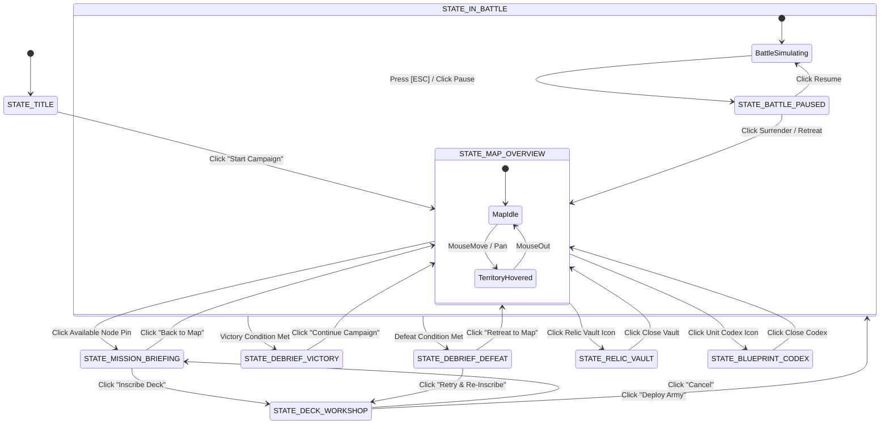

# EPIC BATTLE! — GRAND CONQUEST MODE: MASTER TECHNICAL DESIGN DOCUMENT (TDD / GDD)
**Document Version:** 2.0.0 (Production Master Specification)  
**System Classification:** Single-Player Narrative Campaign, World Map Territory Domination & Tech Tree Progression  
**Target Environments:** 
- **2D Web Engine:** HTML5 Canvas, Vanilla ES2022, Tailwind CSS (`epic_battle_2d`)
- **3D Engine:** Roblox Studio Luau, Client-Server Architecture, DataStoreService (`epic_battle`)

---

## TABLE OF CONTENTS
1. [Core Design Philosophy & Anti-Ambiguity Mandate](#1-core-design-philosophy--anti-ambiguity-mandate)
2. [Master Architecture & State Machine](#2-master-architecture--state-machine)
3. [World Map Cartography & Coordinate Engine](#3-world-map-cartography--coordinate-engine)
4. [Exhaustive 24-Mission Catalogue (Chapters 1 through 6)](#4-exhaustive-24-mission-catalogue-chapters-1-through-6)
5. [The 5 Mission Archetype Execution Engines](#5-the-5-mission-archetype-execution-engines)
6. [The 15 War Relics Master Catalog & Exact Math Formulas](#6-the-15-war-relics-master-catalog--exact-math-formulas)
7. [The 54-Unit Blueprint Tech Tree & Cross-Faction System](#7-the-54-unit-blueprint-tech-tree--cross-faction-system)
8. [Unified Data Schema, Save Serialization & Checksum Validation](#8-unified-data-schema-save-serialization--checksum-validation)
9. [2D HTML5 Implementation Architecture (`epic_battle_2d`)](#9-2d-html5-implementation-architecture-epic_battle_2d)
10. [3D Roblox Studio Implementation Architecture (`epic_battle`)](#10-3d-roblox-studio-implementation-architecture-epic_battle)
11. [QA Acceptance Criteria & Verification Matrix](#11-qa-acceptance-criteria--verification-matrix)

---

## 1. CORE DESIGN PHILOSOPHY & ANTI-AMBIGUITY MANDATE

### 1.1 The Anti-Prompt-Drift Mandate
Typical AI-generated documentation relies on placeholders (e.g. *"repeat for other missions"* or *"balance as appropriate"*). When implementing complex systems, these omissions force developers or AI coding agents to improvise, resulting in broken dependencies, missing assets, and unplayable states. 

**This document specifies EVERY numerical constant, coordinate, object schema, formula, dialogue line, and trigger condition.** No developer or AI shall need to invent any data point during implementation.

### 1.2 The Core Fantasy
The player acts as the Grand Strategist of a planetary expeditionary force attempting to bring order to the fractured world of **Geo-Terra**. The world is divided into six sovereign faction territories:
1. **Solaris Empire (Kingdom):** Feudal, chivalric holy knights, battle mages, and regeneration clergy.
2. **Aegis Coalition (Republic):** High-tech militarized police, riot suppressors, and sniper ballistics.
3. **Hive Mind (Alien):** Swarming subterranean bio-terrors, corrosive acid spitters, and brood matriarchs.
4. **Hellfire Legion (Demon):** Brimstone zealots, reckless berserkers, soul harvesters, and vampiric archdemons.
5. **Abyssal Void (Void):** Reality-bending shadow stalkers, anti-death chronomancers, and armor-decay auras.
6. **Mechanica Corps (Mechanica):** Colossal autonomous walkers, heavy diesel tanks, and overclocked artillery networks.

### 1.3 Core Loop
```
[World Map] -> [Territory Inspection & Briefing] -> [Deck Workshop & Counter-Building] 
            -> [Battle Encounter] -> [Post-Battle Auditing (Stars)] 
            -> [Blueprint / Relic Unlocking] -> [Territory Color Flip on Map]
```

---

## 2. MASTER ARCHITECTURE & STATE MACHINE

Grand Conquest operates as an explicit, deterministic finite-state machine (FSM). 



### 2.1 State Definitions & Lifecycle Rules
| State Enum | Description | Permitted Inputs | Memory / Resource Lifecycle |
| :--- | :--- | :--- | :--- |
| `STATE_TITLE` | Top splash screen & campaign load selector | Keypress, MouseClick, Profile Selection | Audio: Ambient Title Theme. Disposes previous battle state. |
| `STATE_MAP_OVERVIEW` | 2D/3D Interactive World Map | Pan (Drag / WASD), Zoom (Wheel / Pinch), Node Click | Renders map canvas/3D terrain. Loads player save data. |
| `STATE_MISSION_BRIEFING` | Mission intel modal: objective, enemy deck, stars | `[ESC]` (Close), `[Enter]` (Inscribe Deck) | Freezes map panning. Previews enemy unit thumbnails. |
| `STATE_DECK_WORKSHOP` | 6-card Grimoire editor + 2 Relic sockets | Click Card to Swap, Click Relic to Equip, `[Deploy]` | Validates 2C / 2B / 2A structure. Locks invalid decks. |
| `STATE_IN_BATTLE` | Active 30Hz+ simulation loop | `[1]-[6]`, `[U]`, `[T]`, `[Q]`, `[E]`, `[ESC]` | Allocates match entities. Starts clock and wave queue. |
| `STATE_BATTLE_PAUSED` | In-match pause dialog | Resume, Restart Match, Surrender | Halts simulation clock `dt = 0`. Renders backdrop blur. |
| `STATE_DEBRIEF_VICTORY`| Stars tally, Blueprint splash, Bounty reveal | `[Continue]`, `[Replay]` | Saves state to `localStorage` / `DataStore`. Plays victory fanfare. |
| `STATE_DEBRIEF_DEFEAT` | Loss recap, hint banner, retry button | `[Retry]`, `[Map]` | No save state mutation except match attempt counter. |
| `STATE_RELIC_VAULT` | Hall of 15 relics, star unlock milestones | Socket Click, Close | Modal over map. Updates active relic cache. |
| `STATE_BLUEPRINT_CODEX`| Lore, 54 unit stats, 3D rig inspect | Unit selection, Close | Renders animated 2D/3D sprite viewer. |

---

## 3. WORLD MAP CARTOGRAPHY & COORDINATE ENGINE

### 3.1 Normalized Map Canvas Space
To ensure identical camera framing and node placement across all screens (desktop, mobile, tablet, Roblox viewport):
- **Virtual Map Resolution:** Fixed $2000 	imes 1200$ coordinate grid.
- **Viewport Bounds:** Viewport dimensions are scaled to preserve an aspect ratio of `5:3`.
- **Camera Pan Clamping:** 
  $$	ext{camX} \in [0, 2000 - 	ext{viewportWidth}], \quad 	ext{camY} \in [0, 1200 - 	ext{viewportHeight}]$$
- **Camera Zoom Limits:** $	ext{scale} \in [0.65, 1.85]$. Default initial zoom is $1.0$.

### 3.2 Continental Regional Boundaries (Polygon Coordinates)
The world of Geo-Terra consists of 6 regional domains on the $2000 	imes 1200$ canvas:

```
+-----------------------------------------------------------------------------------+
| [CH. 4: ABYSSAL VOID]               | [CH. 6: SECTOR ZERO (MECHANICA)]           |
| NW Region: (50, 50) to (950, 550)   | NE Region: (1050, 50) to (1950, 550)       |
| Dominant Color: Deep Purple #581c87 | Dominant Color: Cyber Cyan/Orange #c2410c   |
|-------------------------------------+---------------------------------------------|
| [CH. 1: SOLARIS EMPIRE]             | [CH. 2: AEGIS COALITION]                    |
| Center-West: (50, 600) to (950, 850)| Center-East: (1050, 600) to (1950, 850)     |
| Dominant Color: Imperial Gold #b45309| Dominant Color: Tactical Navy #1e3a8a      |
|-------------------------------------+---------------------------------------------|
| [CH. 3: THE CHITIN WASTES (HIVE)]   | [CH. 5: BRIMSTONE CRUCIBLE (HELLFIRE)]      |
| SW Region: (50, 900) to (950, 1150) | SE Region: (1050, 900) to (1950, 1150)      |
| Dominant Color: Acid Lime #4d7c0f   | Dominant Color: Molten Crimson #991b1b      |
+-----------------------------------------------------------------------------------+
```

### 3.3 Node Pin Anatomy & Visual States
Every territory node on the map is rendered as an interactive tactical pin with the following components:
1. **Outer Ring (Radius: 28px):** 
   - Pulse animation if `UNLOCKED_UNPLAYED` (scale 1.0 to 1.15 oscillating at 1.5Hz).
   - Solid gold `#eab308` border if 3-star completed.
   - Solid silver `#94a3b8` if 1-star or 2-star completed.
   - Dashed dark-slate `#475569` if `LOCKED`.
2. **Inner Circle (Radius: 24px):**
   - Background filled with occupying faction's theme color.
   - Central icon:
     - ⚔️ Crossed Swords (Siege)
     - 🛡️ Tower Shield (Hold the Line)
     - ⚡ Lightning Bolt (Blitzkrieg)
     - 👑 Crown / Skull (Titan Slayer)
     - ☣️ Hazard Sign (Mutator)
3. **Star Rating Badge (Bottom Center, Offset Y: +22px):**
   - Renders 3 miniature star icons: ★ filled gold `#facc15`, ☆ hollow slate `#64748b`.
4. **Territory Title Banner (Below Pin, Offset Y: +36px):**
   - Semi-transparent black pill (`rgba(2, 6, 23, 0.85)`) with white bold text (`11px Inter`).
5. **Connection Road Lines:**
   - Quadratic Bézier spline connecting prerequisite nodes.
   - If target node is `LOCKED`: dashed line (`rgba(100, 116, 139, 0.4)`).
   - If target node is `UNLOCKED`: animated glowing pulse along line (`rgba(59, 130, 246, 0.8)`).
   - If target node is `COMPLETED`: solid gold line (`#eab308`).

## 4. EXHAUSTIVE 24-MISSION CATALOGUE (CHAPTERS 1 THROUGH 6)

Every mission in the Grand Conquest campaign is an authoritatively configured tactical scenario. Below is the full 24-mission master catalog.

---

### CHAPTER 1: THE SUN-GILDED PLAINS (SOLARIS EMPIRE)
*Theme:* Traditional army formations, defensive battlements, holy divine magic.  
*Continent Map Coordinates:* (50, 600) to (950, 850).

#### Mission 1.1: "The Sun-Gilded Border"
- **Mission ID:** `M1_1`
- **Territory Name:** Solaris Outpost Alpha
- **Map Pin Coordinate:** `(220, 720)`
- **Prerequisites:** None (Campaign Starter Mission)
- **Archetype:** `siege` (Standard Fortification Siege: T1 -> T2 -> Base)
- **Narrative Briefing:**  
  *Commander Vance:* "Our expedition has made landfall on the golden shores of the Solaris Empire. Their border sentries have raised their banners and refuse our parley. Secure the border gate and demonstrate the strength of our legion."
- **Enemy Commander AI:**
  - *Faction:* `solaris`
  - *AI Difficulty:* `Easy` (Income Multiplier: 0.85x, Decision Timer: 1.5s)
  - *Starting Gold:* 40G
  - *Deck:* `sol_1` (Footman), `sol_2` (Archer), `sol_3` (Shield Man)
- **Fortification Stats:**
  - Player: Base (1500 HP), T2 (600 HP), T1 (450 HP)
  - Enemy: Base (1500 HP), T2 (600 HP), T1 (450 HP)
- **3-Star Commendation Criteria:**
  - ★ **Liberator:** Destroy the enemy Base Tower.
  - ★★ **Steel Wall:** Player Outer Turret 1 (T1) remains standing with $\ge 50\%$ HP (225+ HP).
  - ★★★ **Swift Victory:** Conclude the match in under 3 Minutes and 00 Seconds (180.0s).
- **Rewards:**
  - *Blueprint Unlock:* `sol_4` (Solaris Knight - B-Tier Veteran, 160 HP, -25% DMG Taken)
  - *Gold Bounty:* +100G Account Vault
  - *Unlocks Next Mission:* `M1_2`

---

#### Mission 1.2: "The Gilded Abbey"
- **Mission ID:** `M1_2`
- **Territory Name:** Sanctuary of Saint Lyra
- **Map Pin Coordinate:** `(410, 680)`
- **Prerequisites:** `M1_1`
- **Archetype:** `hold_the_line` (Wave Defense)
- **Narrative Briefing:**  
  *Commander Vance:* "The Solaris Clergy has rallied their knights to reclaim the Abbey. Our forward outpost is cut off from reinforcements! Dig in and hold the perimeter for 2 minutes and 30 seconds until the supply zeppelin arrives!"
- **Mission Timetable & Wave Queue:**
  - Total Defense Timer: **150.0 Seconds** (2:30 min).
  - *Enemy Base:* Invulnerable. Enemy spawns via scheduled wave drops.
  - *Player Passive Income:* Boosted to +6G/s base rate (+100% bonus).
  - **Wave Timetable:**
    - `00:10`: 4x `sol_1` (Footman) [Lane Y: 150, 220, 300, 380]
    - `00:35`: 2x `sol_3` (Shield Man) + 3x `sol_2` (Archer)
    - `01:05`: 3x `sol_4` (Knight) + 2x `sol_6` (Priest - Healer Wave)
    - `01:40`: 6x `sol_1` (Footman Swarm) + 4x `sol_2` (Archer Volley)
    - `02:10` (FINAL CRUSH): 4x `sol_4` (Knight) + 2x `sol_6` (Priest) + 4x `sol_3` (Shield Man)
- **3-Star Commendation Criteria:**
  - ★ **Survivor:** Defend the perimeter until the timer hits 00:00 without Base Tower falling.
  - ★★ **Impenetrable:** Outer Turret 1 (T1) remains standing.
  - ★★★ **Purification:** Eliminate at least 35 enemy invaders during the siege.
- **Rewards:**
  - *Blueprint Unlock:* `sol_6` (Solaris Priest - B-Tier Support, Heals 20 HP/3s)
  - *Feature Unlock:* **Tier 2 Tech Upgrade [T]** unlocked in Campaign Mode!
  - *Gold Bounty:* +150G Account Vault
  - *Unlocks Next Mission:* `M1_3`

---

#### Mission 1.3: "Ramparts of the Sun"
- **Mission ID:** `M1_3`
- **Territory Name:** The Sunken Bastion
- **Map Pin Coordinate:** `(630, 750)`
- **Prerequisites:** `M1_2`
- **Archetype:** `mutator` (Battlefield Environmental Hazard)
- **Active Mutator:**
  - *Name:* **Consecrated Solar Conduits**
  - *Rule:* Sacred beams bathe the battlefield. All healing effects (`Cross` shapes and spells) heal for **+50% additional HP**, but all ranged projectile damage (`Triangle` marksmen) is reduced by **-20%** due to blinding radiance.
- **Enemy Commander AI:**
  - *Faction:* `solaris`
  - *AI Difficulty:* `Normal` (Income Multiplier: 1.0x, Decision Timer: 1.1s)
  - *Starting Gold:* 60G
  - *Deck:* `sol_1`, `sol_3`, `sol_4`, `sol_5` (Mage), `sol_6` (Priest)
- **3-Star Commendation Criteria:**
  - ★ **Victor:** Shatter the Sunken Bastion and destroy the enemy Base.
  - ★★ **Fiscal Mastery:** Reach and maintain an Income Level of $\ge 	ext{Lvl } 5$ before winning.
  - ★★★ **Tactical Purity:** Complete the mission without deploying any `Triangle` (Ranged) units.
- **Rewards:**
  - *Blueprint Unlock:* `sol_5` (Solaris Mage - B-Tier Arcane Artillery, 4th Hit: 45 DMG)
  - *Gold Bounty:* +175G Account Vault
  - *Unlocks Next Mission:* `M1_4_BOSS`

---

#### Mission 1.4: "High Cathedral of Radiance" (CHAPTER 1 CLIMAX)
- **Mission ID:** `M1_4_BOSS`
- **Territory Name:** Grand Cathedral of High Solaris
- **Map Pin Coordinate:** `(850, 710)`
- **Prerequisites:** `M1_3`
- **Archetype:** `titan_slayer` (Colossal Boss Encounter)
- **Boss Specification:**
  - *Boss Unit Name:* **Grand Paladin Aurelius**
  - *Base Archetype:* `solaris_elite_knight` (`sol_7`)
  - *Scale Multiplier:* **1.95x** (Hitbox Radius: 32px)
  - *Health (HP):* **2,800 HP** (Max: 2,800)
  - *Damage:* 45 DMG Melee Cleave
  - *Range:* 7.5 studs (64px)
  - *Attack Speed (CD):* 0.95s
  - *Movement Speed:* 10.5 studs/s (Slow, unstoppable march)
  - *Innate Passives:* 
    - `-30% Damage Taken` from all physical melee attacks.
    - **Aura of Radiance (28 studs):** Allies within range gain +15% attack speed and heal 25 HP every 6.0 seconds.
  - *Telegraphed Ability (Every 16s):* **Judgement of the Sun** (Charges for 1.8s with golden halo &rarr; slams ground dealing 95 AoE DMG in a 140px radius).
- **Enemy Support AI:**
  - *Spawns alongside Boss:* Regular waves of `sol_1` (Footman) and `sol_6` (Priest).
- **3-Star Commendation Criteria:**
  - ★ **Kingslayer:** Slay Grand Paladin Aurelius and topple the Cathedral Base.
  - ★★ **Unyielding:** Inner Turret 2 (T2) never takes damage.
  - ★★★ **Legendary Duel:** Slay the Grand Paladin in under 3 Minutes and 15 Seconds (195.0s).
- **Rewards:**
  - *Blueprint Unlock:* `sol_7` (Solaris Elite Knight - A-Tier Mythic Juggernaut)
  - *Feature Unlock:* **Tier 3 Tech Upgrade [T]** unlocked in Campaign Mode!
  - *Liberation Trophy:* **Solaris Suncrest Medal** (Liberated Solaris Empire)
  - *Unlocks Next Chapters:* Chapter 2 (`M2_1`) AND Chapter 3 (`M3_1`) branching simultaneously!

---

### CHAPTER 2: NEO-VERIDIA SECTOR (AEGIS COALITION)
*Theme:* High-tech police state, ballistic barricades, riot shields, suppressive fire.  
*Continent Map Coordinates:* (1050, 600) to (1950, 850).

#### Mission 2.1: "Checkpoint Alpha: Neon Gates"
- **Mission ID:** `M2_1`
- **Territory Name:** Neo-Veridia Transit Gate 01
- **Map Pin Coordinate:** `(1150, 720)`
- **Prerequisites:** `M1_4_BOSS`
- **Archetype:** `siege` (Standard Fortification Siege)
- **Narrative Briefing:**  
  *Director Kane (Aegis Comms):* "Unidentified armored division, halt immediately. Neo-Veridia airspace and land routes are sealed by executive order. Withdraw or face non-lethal dispersal protocols."  
  *Commander Vance:* "Their automated barricades are formidable, but their ranks lack holy regeneration. Form a tight vanguard and breach the security gates!"
- **Enemy Commander AI:**
  - *Faction:* `aegis`
  - *AI Difficulty:* `Normal` (Income: 1.0x, Decision: 1.05s)
  - *Starting Gold:* 50G
  - *Deck:* `aeg_1` (Riot Trooper), `aeg_2` (Police), `aeg_3` (Medic Bot), `aeg_5` (Riot Shield)
- **3-Star Commendation Criteria:**
  - ★ **Gatebreaker:** Breach Checkpoint Alpha and demolish the Security Bastion.
  - ★★ **Discipline:** Win without any friendly unit being struck by enemy commander [Q] Airstrike.
  - ★★★ **Clean Sweep:** Finish the match in under 2 Minutes and 45 Seconds (165.0s).
- **Rewards:**
  - *Blueprint Unlock:* `aeg_1` (Aegis Riot Trooper - C-Tier Vanguard, 120 HP Frontline Baton)
  - *Blueprint Unlock:* `aeg_2` (Aegis Police - C-Tier Vanguard, 23 Range Sidearm)
  - *Gold Bounty:* +180G Account Vault
  - *Unlocks Next Mission:* `M2_2`

---

#### Mission 2.2: "Cyber-Plaza Blitz"
- **Mission ID:** `M2_2`
- **Territory Name:** Neon Stockade Plaza
- **Map Pin Coordinate:** `(1380, 670)`
- **Prerequisites:** `M2_1`
- **Archetype:** `blitzkrieg` (Timed Speed Assault)
- **Mission Timetable & Countdown:**
  - **Hard Time Limit:** **135.0 Seconds (02:15 min)**.
  - *Orbital Threat Protocol:* If the enemy Base Tower is not destroyed by 02:15, Aegis defense satellites fire a synchronized kinetic orbital strike, instantly wiping out player structures (Defeat).
  - *Player Incentive:* High-tempo Vanguard rushing and early economic commitment.
- **Enemy Commander AI:**
  - *Faction:* `aegis`
  - *AI Difficulty:* `Hard` (Income: 1.15x, Fast Deploy)
  - *Starting Gold:* 80G
  - *Deck:* `aeg_4` (Rifleman), `aeg_5` (Riot Shield), `aeg_6` (Grenade Thrower)
- **3-Star Commendation Criteria:**
  - ★ **Blitz Master:** Demolish the Plaza Base Tower before the 02:15 timer expires.
  - ★★ **Air Superiority:** Cast player Commander Spell `[Q]` at least twice during the blitz.
  - ★★★ **Apex Rush:** Destroy the enemy Base Tower in under 1 Minute and 45 Seconds (105.0s).
- **Rewards:**
  - *Blueprint Unlock:* `aeg_4` (Aegis Rifleman - B-Tier Veteran, Sniper Protocol: 36 Studs Range)
  - *Gold Bounty:* +220G Account Vault
  - *Unlocks Next Mission:* `M2_3`

---

#### Mission 2.3: "Neon Grid Jammer"
- **Mission ID:** `M2_3`
- **Territory Name:** Sub-Level Power Conduits
- **Map Pin Coordinate:** `(1620, 760)`
- **Prerequisites:** `M2_2`
- **Archetype:** `mutator` (Battlefield Environmental Hazard)
- **Active Mutator:**
  - *Name:* **Electromagnetic Interference (EMP Scrambler)**
  - *Rule:* High-voltage conduits overload optical targeting sensors. All ranged projectile attack cooldowns (`Triangle` and `Diamond` shapes) are increased by **+40% slower firing rate**, while all melee units (`Circle` and `Square`) gain **+25% movement speed** due to motor overclocking.
- **Enemy Commander AI:**
  - *Faction:* `aegis`
  - *AI Difficulty:* `Normal`
  - *Starting Gold:* 70G
  - *Deck:* `aeg_1`, `aeg_3` (Medic Bot), `aeg_5` (Riot Shield), `aeg_6` (Grenade Thrower)
- **3-Star Commendation Criteria:**
  - ★ **Overload:** Destroy the Power Conduit Base Tower.
  - ★★ **Close Quarters:** Win with at least 5 melee units (`Square` or `Circle`) alive on field.
  - ★★★ **Economic Supremacy:** Upgrade player income to Level 6 before completing the mission.
- **Rewards:**
  - *Blueprint Unlock:* `aeg_3` (Aegis Medic Bot - C-Tier Support, Heals 10 HP/3s to 3 allies)
  - *Blueprint Unlock:* `aeg_6` (Aegis Grenade Thrower - B-Tier Specialist, 1st Hit: 50 DMG burst)
  - *Gold Bounty:* +240G Account Vault
  - *Unlocks Next Mission:* `M2_4_BOSS`

---

#### Mission 2.4: "Citadel of Law: The Juggernaut Enforcer" (CHAPTER 2 CLIMAX)
- **Mission ID:** `M2_4_BOSS`
- **Territory Name:** Central Aegis High Command
- **Map Pin Coordinate:** `(1860, 700)`
- **Prerequisites:** `M2_3`
- **Archetype:** `titan_slayer` (Colossal Boss Encounter)
- **Boss Specification:**
  - *Boss Unit Name:* **Enforcer Unit Omega**
  - *Base Archetype:* `aegis_elite_riot` (`aeg_7`)
  - *Scale Multiplier:* **2.05x** (Hitbox Radius: 34px)
  - *Health (HP):* **3,400 HP** (Max: 3,400)
  - *Damage:* 35 DMG Heavy Kinetic Baton
  - *Range:* 7.0 studs (60px)
  - *Attack Speed (CD):* 0.90s
  - *Movement Speed:* 9.8 studs/s
  - *Innate Passives:* 
    - `-25% Damage Taken` from all incoming attacks.
    - **Aegis Tactical Aura (24 studs):** Weakens all enemy units by -20% Armor/Defense.
  - *Telegraphed Ability (Every 12s):* **Suppression Pulse** (Emits a high-frequency flashbang shockwave across the lane dealing 65 AoE DMG and slowing all player units by 50% for 4.0s).
- **Enemy Support AI:**
  - Spawns escort squads of `aeg_4` (Riflemen) and `aeg_3` (Medic Bots).
- **3-Star Commendation Criteria:**
  - ★ **Lawbreaker:** Demolish Enforcer Unit Omega and raze the Central Citadel.
  - ★★ **Fortress Shield:** Player Base Tower suffers zero damage throughout the encounter.
  - ★★★ **Titan Executioner:** Slay Enforcer Unit Omega in under 3 Minutes and 15 Seconds (195.0s).
- **Rewards:**
  - *Blueprint Unlock:* `aeg_7` (Aegis Elite Riot - A-Tier Mythic, -15% DMG, -15% Enemy DEF Aura)
  - *Blueprint Unlock:* `aeg_8` (Aegis Shotgunner - A-Tier Striker, 35 Close / 15 Long DMG)
  - *Liberation Trophy:* **Aegis Star of Valor** (Liberated Aegis Coalition)
  - *Unlocks Next Chapter:* Chapter 4 (`M4_1`)

---

### CHAPTER 3: THE CHITIN WASTES (HIVE MIND)
*Theme:* Underground bio-swarms, corrosive acid, endless reproduction, apex predators.  
*Continent Map Coordinates:* (50, 900) to (950, 1150).

#### Mission 3.1: "Fungal Dunes Outpost"
- **Mission ID:** `M3_1`
- **Territory Name:** Spore Trench Perimeter
- **Map Pin Coordinate:** `(220, 1020)`
- **Prerequisites:** `M1_4_BOSS`
- **Archetype:** `siege` (Standard Fortification Siege)
- **Narrative Briefing:**  
  *Commander Vance:* "The southern continent is choking under a virulent fungal creep. The Alien Hive senses our presence and is spawning thousands of grunts beneath the sand dunes. Maintain firing lines and purge the brood tunnels!"
- **Enemy Commander AI:**
  - *Faction:* `hive`
  - *AI Difficulty:* `Normal` (Fast Swarm Spawner, Income: 1.05x)
  - *Starting Gold:* 40G
  - *Deck:* `hiv_1` (Alien Grunt), `hiv_2` (Plasma Shooter), `hiv_3` (Alien Guard)
- **3-Star Commendation Criteria:**
  - ★ **Exterminator:** Destroy the Spore Trench Base Spire.
  - ★★ **Swarm Breaker:** Slay at least 40 alien units during the match.
  - ★★★ **Rapid Cleansing:** Complete the mission in under 2 Minutes and 45 Seconds (165.0s).
- **Rewards:**
  - *Blueprint Unlock:* `hiv_1` (Hive Alien Grunt - C-Tier Swarmling, 18 DMG, 15.5 Speed)
  - *Blueprint Unlock:* `hiv_2` (Hive Plasma Shooter - C-Tier Marksman, 23 Range)
  - *Gold Bounty:* +180G Account Vault
  - *Unlocks Next Mission:* `M3_2`

---

#### Mission 3.2: "Acid Marsh Survival"
- **Mission ID:** `M3_2`
- **Territory Name:** Caustic Quagmire
- **Map Pin Coordinate:** `(450, 970)`
- **Prerequisites:** `M3_1`
- **Archetype:** `hold_the_line` (Wave Defense)
- **Narrative Briefing:**  
  *Commander Vance:* "Our artillery wagons are bogged down in the caustic quagmire! Alien bio-forms are converging from all flanks. Hold the perimeter for 3 minutes while the recovery team unhitches the treads!"
- **Mission Timetable & Wave Queue:**
  - Total Defense Timer: **180.0 Seconds (03:00 min)**.
  - *Player Income Bonus:* Boosted by +75% (+5.25G/s base rate).
  - **Wave Timetable:**
    - `00:15`: 6x `hiv_1` (Grunt Swarm)
    - `00:45`: 3x `hiv_3` (Alien Guard Carapace) + 3x `hiv_2` (Plasma Shooters)
    - `01:20`: 4x `hiv_4` (Mutated Warriors) + 3x `hiv_6` (Acid Spitters - Poison Barrage!)
    - `02:00`: 8x `hiv_1` (Grunt Rush) + 4x `hiv_4` (Mutated Warriors)
    - `02:35` (APEX BIO-HORDE): 2x `hiv_7` (Alien Juggernauts) + 6x `hiv_6` (Acid Spitters) + 4x `hiv_3` (Alien Guards)
- **3-Star Commendation Criteria:**
  - ★ **Survivor:** Survive the full 3 minutes without Base Tower falling.
  - ★★ **Zero Breach:** Outer Turret 1 (T1) remains alive at 00:00.
  - ★★★ **Antidote Protocol:** Never allow more than 2 friendly units to be poisoned simultaneously.
- **Rewards:**
  - *Blueprint Unlock:* `hiv_6` (Hive Acid Spitter - B-Tier Specialist, 5 Poison DPS for 4.0s)
  - *Blueprint Unlock:* `hiv_4` (Hive Mutated Warrior - B-Tier Bruiser, 140 HP, 25 DMG)
  - *Gold Bounty:* +220G Account Vault
  - *Unlocks Next Mission:* `M3_3`

---

#### Mission 3.3: "Caustic Grotto"
- **Mission ID:** `M3_3`
- **Territory Name:** The Bile Chambers
- **Map Pin Coordinate:** `(680, 1050)`
- **Prerequisites:** `M3_2`
- **Archetype:** `mutator` (Battlefield Environmental Hazard)
- **Active Mutator:**
  - *Name:* **Corrosive Miasma**
  - *Rule:* The cavern atmosphere is dense with digestive acid fumes. Every unit on the battlefield (both player and enemy) takes **2 DMG every 1.5 seconds**, UNLESS they are standing within 110px of an allied structure or an active `Cross` healer shape!
- **Enemy Commander AI:**
  - *Faction:* `hive`
  - *AI Difficulty:* `Hard`
  - *Starting Gold:* 75G
  - *Deck:* `hiv_1`, `hiv_3`, `hiv_4`, `hiv_5` (Plasma Specialist), `hiv_6` (Acid Spitter)
- **3-Star Commendation Criteria:**
  - ★ **Subterranean Conqueror:** Destroy the Bile Chamber Core.
  - ★★ **Master Chemist:** Win with all 3 of your defense structures alive.
  - ★★★ **Surge Mastery:** Cast player Commander Spell `[E]` (Healing/Surge) at least 3 times.
- **Rewards:**
  - *Blueprint Unlock:* `hiv_5` (Hive Plasma Specialist - B-Tier Caster, 35 DMG, 25 Range)
  - *Blueprint Unlock:* `hiv_3` (Hive Alien Guard - C-Tier Blocker, 110 HP Carapace)
  - *Gold Bounty:* +250G Account Vault
  - *Unlocks Next Mission:* `M3_4_BOSS`

---

#### Mission 3.4: "The Broodmother's Hive Core" (CHAPTER 3 CLIMAX)
- **Mission ID:** `M3_4_BOSS`
- **Territory Name:** Spire of the Apex Broodmother
- **Map Pin Coordinate:** `(890, 1000)`
- **Prerequisites:** `M3_3`
- **Archetype:** `titan_slayer` (Colossal Boss Encounter)
- **Boss Specification:**
  - *Boss Unit Name:* **Gorgon Leviathan**
  - *Base Archetype:* `hive_alien_juggernaut` (`hiv_7`)
  - *Scale Multiplier:* **2.15x** (Hitbox Radius: 36px)
  - *Health (HP):* **3,600 HP** (Max: 3,600)
  - *Damage:* 55 DMG Massive Scythe Claws
  - *Range:* 7.5 studs (64px)
  - *Attack Speed (CD):* 1.05s
  - *Movement Speed:* 9.5 studs/s
  - *Innate Passives:* 
    - **Brood Injection:** Spawns 2x `hiv_1` (Alien Grunts) directly at its side every 8.0 seconds.
    - **Thick Carapace:** Ignores the first 5 damage of every incoming hit.
  - *Telegraphed Ability (Every 14s):* **Caustic Acid Vomit** (Spews a 280px toxic stream straight forward along the lane dealing 85 Acid DMG and inflicting 8 Poison DPS for 5.0s to all caught units).
- **Enemy Support AI:**
  - Continuously deploys `hiv_5` (Plasma Specialists) and `hiv_6` (Acid Spitters).
- **3-Star Commendation Criteria:**
  - ★ **Matriarch Slayer:** Slay the Gorgon Leviathan and destroy the Hive Core.
  - ★★ **Immaculate Base:** Player Base Tower sustains zero damage.
  - ★★★ **Apex Hunter:** Slay the Leviathan in under 3 Minutes and 15 Seconds (195.0s).
- **Rewards:**
  - *Blueprint Unlock:* `hiv_7` (Hive Alien Juggernaut - A-Tier Apex Titan, 300 HP, 40 DMG)
  - *Blueprint Unlock:* `hiv_9` (Hive Commander - A-Tier Broodmother, summons 2 Grunts / 11s)
  - *Liberation Trophy:* **Chitin Brood Carapace** (Liberated Hive Mind)
  - *Unlocks Next Chapter:* Chapter 5 (`M5_1`)

---

### CHAPTER 4: THE ABYSSAL RIFT (ABYSSAL VOID)
*Theme:* Gravitational distortion, dark-matter projectiles, death-immunity assassins, armor decay.  
*Continent Map Coordinates:* (50, 50) to (950, 550).

#### Mission 4.1: "Event Horizon Chasm"
- **Mission ID:** `M4_1`
- **Territory Name:** Void Outpost Obsidian
- **Map Pin Coordinate:** `(220, 240)`
- **Prerequisites:** `M2_4_BOSS`
- **Archetype:** `siege` (Standard Fortification Siege)
- **Narrative Briefing:**  
  *Commander Vance:* "We have climbed into the high atmospheric rift where reality bends. The Abyssal Void guards their dark-matter portals with cloaked assassins. Their arrows distort light itself. Establish our base beacon and collapse their forward vortex!"
- **Enemy Commander AI:**
  - *Faction:* `void`
  - *AI Difficulty:* `Normal` (Income: 1.05x, Decision: 1.0s)
  - *Starting Gold:* 50G
  - *Deck:* `voi_1` (Shadowling), `voi_2` (Void Archer), `voi_3` (Dark Sentinel)
- **3-Star Commendation Criteria:**
  - ★ **Void Walker:** Collapse the Obsidian Base Vortex.
  - ★★ **Resolute:** Outer Turret 1 (T1) retains $\ge 60\%$ HP at victory.
  - ★★★ **Swift Collapse:** Conclude the match in under 2 Minutes and 30 Seconds (150.0s).
- **Rewards:**
  - *Blueprint Unlock:* `voi_1` (Void Shadowling - C-Tier Striker, 18 DMG, 15.5 Speed)
  - *Blueprint Unlock:* `voi_2` (Void Archer - C-Tier Marksman, 14 DMG, 24 Range)
  - *Gold Bounty:* +260G Account Vault
  - *Unlocks Next Mission:* `M4_2`

---

#### Mission 4.2: "The Phantom Corridor"
- **Mission ID:** `M4_2`
- **Territory Name:** Corridor of Phantoms
- **Map Pin Coordinate:** `(450, 180)`
- **Prerequisites:** `M4_1`
- **Archetype:** `blitzkrieg` (Timed Speed Assault)
- **Mission Timetable & Countdown:**
  - **Hard Time Limit:** **120.0 Seconds (02:00 min)**.
  - *Singularity Collapse Protocol:* At 02:00, the corridor completely implodes into a singularity, destroying all player units and fortifications.
  - *Enemy Defensive Setup:* Fast Void Stalkers and heavy obsidian guardians block the path.
- **Enemy Commander AI:**
  - *Faction:* `void`
  - *AI Difficulty:* `Hard`
  - *Starting Gold:* 85G
  - *Deck:* `voi_3` (Dark Sentinel), `voi_4` (Void Stalker), `voi_5` (Abyss Mage)
- **3-Star Commendation Criteria:**
  - ★ **Singularity Breaker:** Destroy the Corridor Nexus before 02:00.
  - ★★ **Flawless Vanguard:** Suffer zero deaths on friendly A-Tier Mythic units.
  - ★★★ **Overclocked Blitz:** Destroy the enemy Base in under 1 Minute and 35 Seconds (95.0s).
- **Rewards:**
  - *Blueprint Unlock:* `voi_4` (Void Stalker - B-Tier Assassin, 30 DMG, 14.5 Speed)
  - *Blueprint Unlock:* `voi_5` (Abyss Mage - B-Tier Nuker, 40 DMG, 25 Range)
  - *Gold Bounty:* +290G Account Vault
  - *Unlocks Next Mission:* `M4_3`

---

#### Mission 4.3: "Null-Space Singularity"
- **Mission ID:** `M4_3`
- **Territory Name:** Gravity Distortion Well
- **Map Pin Coordinate:** `(680, 270)`
- **Prerequisites:** `M4_2`
- **Archetype:** `mutator` (Battlefield Environmental Hazard)
- **Active Mutator:**
  - *Name:* **Gravity Inversion & Chrono Stasis**
  - *Rule:* The gravitational well bends spacetime across the lane. The Soul Drainer's Defy Death immunity duration is doubled from 1.0s to **2.0 seconds** for all units with death immunity passives! Furthermore, all projectile trajectories curve slightly toward the center line.
- **Enemy Commander AI:**
  - *Faction:* `void`
  - *AI Difficulty:* `Hard`
  - *Starting Gold:* 90G
  - *Deck:* `voi_1`, `voi_3`, `voi_4`, `voi_6` (Soul Drainer), `voi_8` (Abyssal Sorcerer)
- **3-Star Commendation Criteria:**
  - ★ **Gravity Conqueror:** Destroy the Gravitational Well Generator.
  - ★★ **Defy the Reaper:** Successfully trigger a friendly unit's Death Immunity passive at least 3 times.
  - ★★★ **Untouchable Core:** Win without losing either Turret 1 or Turret 2.
- **Rewards:**
  - *Blueprint Unlock:* `voi_6` (Void Soul Drainer - B-Tier Specialist, Defy Death 1.0s Immunity at 1 HP)
  - *Blueprint Unlock:* `voi_3` (Void Dark Sentinel - C-Tier Blocker, 100 HP)
  - *Gold Bounty:* +310G Account Vault
  - *Unlocks Next Mission:* `M4_4_BOSS`

---

#### Mission 4.4: "The Void Nexus: Herald of Entropy" (CHAPTER 4 CLIMAX)
- **Mission ID:** `M4_4_BOSS`
- **Territory Name:** Sanctum of Sovereign Malakor
- **Map Pin Coordinate:** `(890, 210)`
- **Prerequisites:** `M4_3`
- **Archetype:** `titan_slayer` (Colossal Boss Encounter)
- **Boss Specification:**
  - *Boss Unit Name:* **Sovereign Malakor**
  - *Base Archetype:* `abyssal_void_warden` (`voi_9`)
  - *Scale Multiplier:* **2.10x** (Hitbox Radius: 35px)
  - *Health (HP):* **3,500 HP** (Max: 3,500)
  - *Damage:* 48 DMG Void Scythe
  - *Range:* 7.5 studs (64px)
  - *Attack Speed (CD):* 0.95s
  - *Movement Speed:* 10.0 studs/s
  - *Innate Passives:* 
    - **Entropy Aura (28 studs):** Reduces all enemy armor and defense by **-35%** (highest defense debuff in Geo-Terra).
    - **Phase Shift:** Every 10.0s, enters an ethereal phase for 1.5s where incoming projectile damage is completely nullified.
  - *Telegraphed Ability (Every 16s):* **Black Hole Singularity** (Channels for 1.5s &rarr; pulls all player units within 220px radius inward to center and detonates for 90 Void DMG).
- **Enemy Support AI:**
  - Continuously deploys `voi_8` (Abyssal Sorcerers) and `voi_7` (Void Reapers).
- **3-Star Commendation Criteria:**
  - ★ **Entropy Purged:** Slay Sovereign Malakor and shatter the Void Nexus.
  - ★★ **Inner Sanctum:** Inner Turret 2 (T2) never falls below 50% HP.
  - ★★★ **Grand Chronomancer:** Slay Sovereign Malakor in under 3 Minutes and 00 Seconds (180.0s).
- **Rewards:**
  - *Blueprint Unlock:* `voi_7` (Void Reaper - A-Tier Executioner, 45 DMG, 13.5 Speed)
  - *Blueprint Unlock:* `voi_8` (Abyssal Sorcerer - A-Tier Supreme Nuker, 65 DMG, 28 Range)
  - *Blueprint Unlock:* `voi_9` (Void Warden - A-Tier Mythic, -20% DEF Aura)
  - *Liberation Trophy:* **Heart of the Void Singularity** (Liberated Abyssal Void)
  - *Unlocks Next Chapter:* Chapter 5 (`M5_1`) & Chapter 6 (`M6_1`)

---

### CHAPTER 5: THE BRIMSTONE CRUCIBLE (HELLFIRE LEGION)
*Theme:* Magma seas, demon berserkers, lifesteal sustain, reckless fury, meteor strikes.  
*Continent Map Coordinates:* (1050, 900) to (1950, 1150).

#### Mission 5.1: "Magma Trench Incursion"
- **Mission ID:** `M5_1`
- **Territory Name:** Charred Redoubt 01
- **Map Pin Coordinate:** `(1150, 1020)`
- **Prerequisites:** `M3_4_BOSS`
- **Archetype:** `siege` (Standard Fortification Siege)
- **Narrative Briefing:**  
  *Commander Vance:* "We march across volcanic bridges above rivers of boiling magma. The Hellfire Legion does not take prisoners; their hell hounds are the fastest beasts on Geo-Terra. Hold rank and do not let their speed fracture our formation!"
- **Enemy Commander AI:**
  - *Faction:* `hellfire`
  - *AI Difficulty:* `Normal` (Income: 1.1x, Aggressive Rush)
  - *Starting Gold:* 50G
  - *Deck:* `hel_1` (Imp), `hel_2` (Hell Hound - 16.5 Speed!), `hel_3` (Demon Soldier)
- **3-Star Commendation Criteria:**
  - ★ **Brimstone Cleanser:** Destroy the Charred Redoubt Base.
  - ★★ **Perimeter Defense:** Outer Turret 1 (T1) remains standing with $\ge 75\%$ HP.
  - ★★★ **Hellfire Blitz:** Conclude the match in under 2 Minutes and 30 Seconds (150.0s).
- **Rewards:**
  - *Blueprint Unlock:* `hel_1` (Hellfire Imp - C-Tier Striker, 20 DMG, 16.0 Speed)
  - *Blueprint Unlock:* `hel_2` (Hellfire Hell Hound - C-Tier Beast, Fastest Unit: 16.5 Speed)
  - *Gold Bounty:* +270G Account Vault
  - *Unlocks Next Mission:* `M5_2`

---

#### Mission 5.2: "Blood Gate Siegetrain"
- **Mission ID:** `M5_2`
- **Territory Name:** The Crimson Bastion
- **Map Pin Coordinate:** `(1380, 970)`
- **Prerequisites:** `M5_1`
- **Archetype:** `hold_the_line` (Wave Defense)
- **Narrative Briefing:**  
  *Commander Vance:* "The demon general has sent his armored Blood Knights to crush our beachhead. Their swords drink the blood of our soldiers to heal their own wounds. Anchor our shield wall and repel the invasion waves for 3 minutes!"
- **Mission Timetable & Wave Queue:**
  - Total Defense Timer: **180.0 Seconds (03:00 min)**.
  - *Player Income Bonus:* Boosted by +80% (+5.4G/s base rate).
  - **Wave Timetable:**
    - `00:15`: 6x `hel_2` (Hell Hound Pack - 16.5 Speed sprint!)
    - `00:45`: 4x `hel_3` (Demon Soldier) + 3x `hel_5` (Flame Casters)
    - `01:25`: 4x `hel_4` (Blood Knights - +30 Lifesteal sustain!) + 3x `hel_6` (Soul Reapers)
    - `02:05`: 8x `hel_1` (Imp Swarm) + 4x `hel_4` (Blood Knights)
    - `02:40` (DEMONIC SIEGETRAIN): 2x `hel_7` (Demon Brutes - 350 HP!) + 4x `hel_4` (Blood Knights) + 4x `hel_5` (Flame Casters)
- **3-Star Commendation Criteria:**
  - ★ **Unbroken:** Hold the Crimson Bastion for the full 3 minutes without Base Tower falling.
  - ★★ **Slaughter of Fiends:** Slay at least 50 enemy demons during the defense.
  - ★★★ **Untarnished Fortification:** Win without losing any defense structure (T1, T2, Base all alive).
- **Rewards:**
  - *Blueprint Unlock:* `hel_4` (Hellfire Blood Knight - B-Tier Veteran, 200 HP, +30 HP Lifesteal)
  - *Blueprint Unlock:* `hel_3` (Hellfire Demon Soldier - C-Tier Blocker, 100 HP, 15 DMG)
  - *Gold Bounty:* +300G Account Vault
  - *Unlocks Next Mission:* `M5_3`

---

#### Mission 5.3: "The Infernal Caldera"
- **Mission ID:** `M5_3`
- **Territory Name:** Caldera of Molten Souls
- **Map Pin Coordinate:** `(1620, 1050)`
- **Prerequisites:** `M5_2`
- **Archetype:** `mutator` (Battlefield Environmental Hazard)
- **Active Mutator:**
  - *Name:* **Blood Frenzy & Magma Heat**
  - *Rule:* The searing heat boils the blood of all combatants. ALL units on both sides gain **+35% Attack Speed** and **+25% Movement Speed**, but steadily suffer **1.0% Max HP burn damage per second**. Fights are blazing fast and ultra-lethal!
- **Enemy Commander AI:**
  - *Faction:* `hellfire`
  - *AI Difficulty:* `Hard`
  - *Starting Gold:* 80G
  - *Deck:* `hel_1`, `hel_3`, `hel_4`, `hel_5` (Flame Caster), `hel_6` (Soul Reaper)
- **3-Star Commendation Criteria:**
  - ★ **Caldera Master:** Shatter the Caldera Base Tower.
  - ★★ **Financial Overdrive:** Upgrade player income to Level 6 before completing the match.
  - ★★★ **Fiery Speedrun:** Destroy the enemy Base in under 2 Minutes and 15 Seconds (135.0s).
- **Rewards:**
  - *Blueprint Unlock:* `hel_5` (Hellfire Flame Caster - B-Tier Nuker, 35 DMG, 24 Range)
  - *Blueprint Unlock:* `hel_6` (Hellfire Soul Reaper - B-Tier Assassin, +10 HP on Kill)
  - *Gold Bounty:* +330G Account Vault
  - *Unlocks Next Mission:* `M5_4_BOSS`

---

#### Mission 5.4: "Throne of the Archfiend: Lord Malgok" (CHAPTER 5 CLIMAX)
- **Mission ID:** `M5_4_BOSS`
- **Territory Name:** The Obsidian Skull Citadel
- **Map Pin Coordinate:** `(1860, 1000)`
- **Prerequisites:** `M5_3`
- **Archetype:** `titan_slayer` (Colossal Boss Encounter)
- **Boss Specification:**
  - *Boss Unit Name:* **Arch-Demon Lord Malgok**
  - *Base Archetype:* `hellfire_demon_lord` (`hel_9`)
  - *Scale Multiplier:* **2.20x** (Hitbox Radius: 38px)
  - *Health (HP):* **4,200 HP** (Max: 4,200)
  - *Damage:* 65 DMG Flaming Greatsword
  - *Range:* 7.5 studs (64px)
  - *Attack Speed (CD):* 0.90s
  - *Movement Speed:* 10.5 studs/s
  - *Innate Passives:* 
    - **Greater Vampiric Leech:** Heals for **+50 HP** on every successful melee strike!
    - **Demon King's Resilence:** Takes -20% less damage from ranged attacks.
  - *Telegraphed Ability (Every 14s):* **Cataclysmic Meteor Rain** (Roars and summons 3 molten meteors slamming down in sequence across player ranks, each dealing 115 AoE DMG in a 120px radius).
- **Enemy Support AI:**
  - Continuously deploys `hel_7` (Demon Brutes - 350 HP) and `hel_8` (Infernal Archmages - 60 DMG nukers).
- **3-Star Commendation Criteria:**
  - ★ **Demon King Toppled:** Slay Arch-Demon Lord Malgok and raze the Skull Citadel.
  - ★★ **Stalwart Base:** Player Base Tower sustains at least 1,200 HP at match conclusion.
  - ★★★ **Exterminatus:** Slay Lord Malgok in under 3 Minutes and 30 Seconds (210.0s).
- **Rewards:**
  - *Blueprint Unlock:* `hel_7` (Hellfire Demon Brute - A-Tier Titan, 350 HP Behemoth)
  - *Blueprint Unlock:* `hel_8` (Hellfire Infernal Archmage - A-Tier Nuker, 60 DMG)
  - *Blueprint Unlock:* `hel_9` (Hellfire Demon Lord - A-Tier Supreme Mythic, +50 Lifesteal)
  - *Liberation Trophy:* **The Horn of Malgok** (Liberated Hellfire Legion)
  - *Unlocks Final Chapter:* Chapter 6 (`M6_1`)

---

### CHAPTER 6: SECTOR ZERO: THE CORE (MECHANICA CORPS) — CAMPAIGN GRAND FINALE
*Theme:* Automated cybernetics, colossal dreadnought mechs, titanium railguns, self-repair nanobots, total planetary automation.  
*Continent Map Coordinates:* (1050, 50) to (1950, 550).

#### Mission 6.1: "Automated Perimeter Breaker"
- **Mission ID:** `M6_1`
- **Territory Name:** Cyber-Citadel Trench 01
- **Map Pin Coordinate:** `(1150, 240)`
- **Prerequisites:** `M4_4_BOSS` and `M5_4_BOSS` (Requires liberating both Void and Hellfire continents)
- **Archetype:** `siege` (Standard Fortification Siege)
- **Narrative Briefing:**  
  *Grand Core AI (Sub-Vocal Transmit):* "Intruder signatures confirmed. Sovereign lifeforms detected outside authorized maintenance corridors. Deploying automated tier-one defense protocol. Extermination mandated."  
  *Commander Vance:* "We have arrived at Sector Zero, the central brain of Geo-Terra. The Mechanica Corps builds war machines that feel no pain, fear, or exhaustion. Advance with heavy blockers and shatter their frontline sentries!"
- **Enemy Commander AI:**
  - *Faction:* `mechanica`
  - *AI Difficulty:* `Hard` (Income: 1.15x, High Armor)
  - *Starting Gold:* 60G
  - *Deck:* `mec_1` (Combat Bot), `mec_2` (Assault Drone), `mec_3` (Shield Robot - 150 HP Titanium wall)
- **3-Star Commendation Criteria:**
  - ★ **Network Infiltrator:** Destroy the Cyber-Citadel Base Tower.
  - ★★ **Steel Conservation:** Suffer fewer than 10 total friendly unit casualties during the entire battle.
  - ★★★ **Swift Dismantling:** Finish the match in under 2 Minutes and 45 Seconds (165.0s).
- **Rewards:**
  - *Blueprint Unlock:* `mec_1` (Mechanica Combat Bot - C-Tier Infantry, 100 HP, 15 DMG)
  - *Blueprint Unlock:* `mec_2` (Mechanica Assault Drone - C-Tier Drone, 24 Range, 14.5 Speed)
  - *Gold Bounty:* +350G Account Vault
  - *Unlocks Next Mission:* `M6_2`

---

#### Mission 6.2: "Siege Engine Blitzkrieg"
- **Mission ID:** `M6_2`
- **Territory Name:** Railgun Assembly Foundry
- **Map Pin Coordinate:** `(1380, 180)`
- **Prerequisites:** `M6_1`
- **Archetype:** `blitzkrieg` (Timed Speed Assault)
- **Mission Timetable & Countdown:**
  - **Hard Time Limit:** **140.0 Seconds (02:20 min)**.
  - *Overcharge Superlaser Protocol:* At 02:20, the foundry superlasers complete charging and vaporize the player's forces in a single planetary blast.
  - *Enemy Defensive Setup:* Heavy Warbots and long-range Plasma Cannons guard the core power couplings.
- **Enemy Commander AI:**
  - *Faction:* `mechanica`
  - *AI Difficulty:* `Hard`
  - *Starting Gold:* 90G
  - *Deck:* `mec_3` (Shield Robot), `mec_4` (Warbot), `mec_5` (Plasma Robot)
- **3-Star Commendation Criteria:**
  - ★ **Core Meltdown:** Destroy the Assembly Foundry Base before 02:20.
  - ★★ **Overclock Cast:** Cast Commander Spell `[Q]` at least twice during the siege.
  - ★★★ **Mach-Speed Breaker:** Destroy the enemy Base in under 1 Minute and 45 Seconds (105.0s).
- **Rewards:**
  - *Blueprint Unlock:* `mec_4` (Mechanica Warbot - B-Tier Enforcer, 200 HP, 25 DMG)
  - *Blueprint Unlock:* `mec_5` (Mechanica Plasma Robot - B-Tier Cannon, 120 HP, 35 DMG, 25 Range)
  - *Gold Bounty:* +380G Account Vault
  - *Unlocks Next Mission:* `M6_3`

---

#### Mission 6.3: "Overclocked Factory Core"
- **Mission ID:** `M6_3`
- **Territory Name:** Nanite Fusion Reactor
- **Map Pin Coordinate:** `(1620, 270)`
- **Prerequisites:** `M6_2`
- **Archetype:** `mutator` (Battlefield Environmental Hazard)
- **Active Mutator:**
  - *Name:* **Autonomous Nanite Regeneration Matrix**
  - *Rule:* Microscopic repair nanites infuse the atmosphere. All mechanical and armor-plated units (`Square` and `Hexagon` shapes) automatically **regenerate 5% of their Max HP every 3.0 seconds**, and their movement speed is increased by **+20%**. Player must utilize burst damage or high-frequency shooters to overwhelm the nanite healing rate!
- **Enemy Commander AI:**
  - *Faction:* `mechanica`
  - *AI Difficulty:* `Extreme` (Income: 1.35x, Aggressive Tech)
  - *Starting Gold:* 100G
  - *Deck:* `mec_1`, `mec_3`, `mec_4`, `mec_6` (Repair Bot), `mec_8` (Heavy Artillery Bot)
- **3-Star Commendation Criteria:**
  - ★ **Reactor Breached:** Destroy the Nanite Fusion Reactor Base.
  - ★★ **Full Siege Demolition:** Destroy all three enemy defense structures (T1, T2, and Base).
  - ★★★ **Economic Apex:** Upgrade player income to Level 7 before match completion.
- **Rewards:**
  - *Blueprint Unlock:* `mec_6` (Mechanica Repair Bot - B-Tier Medic, Heals 25 HP/6s to 5 allies)
  - *Blueprint Unlock:* `mec_3` (Mechanica Shield Robot - C-Tier Titan Wall, 150 HP)
  - *Gold Bounty:* +420G Account Vault
  - *Unlocks Next Mission:* `M6_4_FINAL_BOSS`

---

#### Mission 6.4: "The Core Prime: Cybernetic Colossus" (GRAND CONQUEST CLIMAX & FINAL BATTLE)
- **Mission ID:** `M6_4_FINAL_BOSS`
- **Territory Name:** Central Processing Throne: Geo-Terra Core
- **Map Pin Coordinate:** `(1860, 210)`
- **Prerequisites:** `M6_3`
- **Archetype:** `titan_slayer` (Apex Campaign Boss Encounter)
- **Boss Specification:**
  - *Boss Unit Name:* **Colossus Prime (The Autonomous Overlord)**
  - *Base Archetype:* `mechanica_destroyer_mech` (`mec_7`)
  - *Scale Multiplier:* **2.40x** (Hitbox Radius: 42px — Largest entity on Geo-Terra)
  - *Health (HP):* **5,500 HP** (Max: 5,500)
  - *Damage:* 75 DMG Dual Heavy Autocannons
  - *Range:* 8.5 studs (72px)
  - *Attack Speed (CD):* 0.95s
  - *Movement Speed:* 9.0 studs/s (Slow, crushing march)
  - *Boss Phases & Innate Abilities:*
    - **Phase 1 (100% - 50% HP):** Standard combat with **Cybernetic Speed Aura (28 studs)** providing +20% Attack Speed to all accompanying warbots.
    - **Phase 2 Trigger (At 50% HP = 2,750 HP):** **EMERGENCY NANO-BARRIER!** Colossus Prime emits an emergency klaxon and gains an immediate **+1,200 HP Energy Shield** that must be depleted before actual HP takes damage!
    - **Phase 3 Trigger (At 25% HP = 1,375 HP):** **OVERCLOCK RAGE!** Attack speed increases by +35% and move speed increases by +25%.
  - *Telegraphed Ability (Every 18s):* **Orbital Ion Cannon Death-Ray** (A targeting reticle locks onto the highest-health player unit for 2.0s &rarr; calls down a massive blue orbital beam dealing 160 AoE DMG and leaving a persistent plasma crater for 5s).
- **Enemy Support AI:**
  - Deploys escort squads of `mec_8` (Heavy Artillery Bots - 65 DMG) and `mec_9` (Cybernetic Commanders).
- **3-Star Commendation Criteria:**
  - ★ **Planetary Sovereign:** Slay Colossus Prime and liberate all of Geo-Terra!
  - ★★ **Master Tactician:** Player Outer Turret 1 (T1) survives the final boss encounter.
  - ★★★ **The Ultimate Triumph:** Defeat Colossus Prime in under 4 Minutes and 00 Seconds (240.0s).
- **Rewards:**
  - *Blueprint Unlock:* `mec_7` (Mechanica Destroyer Mech - A-Tier Colossus, 400 HP, 45 DMG)
  - *Blueprint Unlock:* `mec_8` (Mechanica Heavy Artillery Bot - A-Tier Artillery, 65 DMG, 29 Range)
  - *Blueprint Unlock:* `mec_9` (Mechanica Cybernetic Commander - A-Tier Aura Mythic, +20% ATK Spd Aura)
  - *Grand Conquest Trophy:* **Crown of Geo-Terra** (100% Campaign Completion!)
  - *Master Account Bounty:* +1,000G Account Vault & Permanent Golden Commander Name Tag!

---

## 5. THE 5 MISSION ARCHETYPE EXECUTION ENGINES

To guarantee that any AI or human engineer can implement the simulation logic without guesswork, the five mission archetypes are defined below with exact algorithmic pseudocode and deterministic event hooks.

### 5.1 Archetype 1: Standard Fortification Siege (`siege`)
```
INITIALIZATION:
  state.structures = [
    // Player
    { id: "p_base", team: "blue", order: 3, hp: 1500, maxHp: 1500, radius: 38 },
    { id: "p_t2",   team: "blue", order: 2, hp: 600,  maxHp: 600,  radius: 25 },
    { id: "p_t1",   team: "blue", order: 1, hp: 450,  maxHp: 450,  radius: 22 },
    // Enemy
    { id: "e_t1",   team: "red",  order: 1, hp: 450,  maxHp: 450,  radius: 22 },
    { id: "e_t2",   team: "red",  order: 2, hp: 600,  maxHp: 600,  radius: 25 },
    { id: "e_base", team: "red",  order: 3, hp: 1500, maxHp: 1500, radius: 38 }
  ]

UPDATE LOOP (each tick dt):
  1. Standard economy ticks: player.gold += getIncomeRate(player.incomeLvl) * dt
  2. Sequential Turret Rule evaluation:
     function isStructureVulnerable(st):
       return st.hp > 0 AND NOT exists s in sameTeam(st) where s.order < st.order AND s.hp > 0
  3. Win Condition:  Enemy Base (e_base.hp <= 0) -> Transition to STATE_DEBRIEF_VICTORY
  4. Loss Condition: Player Base (p_base.hp <= 0) -> Transition to STATE_DEBRIEF_DEFEAT
```

### 5.2 Archetype 2: Hold the Line (Wave Defense) (`hold_the_line`)
```
INITIALIZATION:
  state.defenseTimer = mission.timeLimitSeconds // e.g. 150.0s or 180.0s
  state.waveQueue = deepCopy(mission.waves)     // Sorted by triggerSec ascending
  state.structures.find(s => s.id === "e_base").isInvulnerable = true
  state.structures.find(s => s.id === "e_base").hpText = "NEXUS [INVULNERABLE]"

UPDATE LOOP (each tick dt):
  state.defenseTimer -= dt
  // Update HUD countdown display
  hudClock.text = formatTime(state.defenseTimer) + " REMAINING"

  // Process Wave Queue
  for each wave in state.waveQueue:
    if state.time >= wave.triggerSec AND NOT wave.fired:
      wave.fired = true
      displayBannerAlert("WARNING: " + wave.alertName, "#f43f5e")
      for each spawn in wave.spawns:
        for i = 0 to spawn.count - 1:
          spawnUnitEntity(state, "red", getUnitDef(spawn.unitId), isFree=true, 
                          customPos={ x: WORLD_W - 130 - (i * 20), y: spawn.yOffset })

  // Win Condition: Timer reaches zero while Player Base is still standing
  if state.defenseTimer <= 0 AND state.structures.find(s => s.id === "p_base").hp > 0:
    state.over = true
    state.winner = "blue"
    triggerDebriefVictory()

  // Loss Condition: Player Base is destroyed before timer hits zero
  if state.structures.find(s => s.id === "p_base").hp <= 0:
    state.over = true
    state.winner = "red"
    triggerDebriefDefeat()
```

### 5.3 Archetype 3: Blitzkrieg (Timed Speed Assault) (`blitzkrieg`)
```
INITIALIZATION:
  state.blitzTimer = mission.timeLimitSeconds // e.g. 135.0s (02:15) or 120.0s (02:00)

UPDATE LOOP (each tick dt):
  state.blitzTimer -= dt
  hudClock.text = formatTime(state.blitzTimer) + " BLITZ TIME"
  
  if state.blitzTimer <= 20.0:
    // Critical Audio & Visual Warning: Screen edge flashes red
    renderVignetteFlash("#ef4444", frequency = 2.0Hz)

  // Win Condition: Enemy Base destroyed before timer expires
  if state.structures.find(s => s.id === "e_base").hp <= 0:
    state.over = true
    state.winner = "blue"
    triggerDebriefVictory()

  // Loss Condition: Timer hits zero -> Immediate orbital strike wipes player
  if state.blitzTimer <= 0:
    state.over = true
    state.winner = "red"
    triggerCinematicOrbitalWipeout(target="blue")
    triggerDebriefDefeat()
```

### 5.4 Archetype 4: Titan Slayer (Colossal Boss Encounter) (`titan_slayer`)
```
INITIALIZATION:
  // Boss is spawned directly at the enemy base at match start
  bossDef = createTitanBossEntity(mission.bossProps)
  state.units.push(bossDef)

BOSS CONTROLLER LOGIC (each tick dt):
  // 1. Boss Phase State Machine
  healthPercent = boss.hp / boss.maxHp

  // Phase 2 Trigger (At 50% HP):
  if healthPercent <= 0.50 AND boss.phase == 1:
    boss.phase = 2
    if bossDef.hasPhase2Shield:
      boss.shieldHp = bossDef.phase2ShieldAmount // e.g. +1200 Shield
      displayBannerAlert(boss.name + " ACTIVATED ENERGY SHIELD!", "#38bdf8")
      triggerShieldVfx(boss)

  // Phase 3 Trigger (At 25% HP):
  if healthPercent <= 0.25 AND boss.phase == 2:
    boss.phase = 3
    boss.spd = boss.spd * 1.25
    boss.cd = boss.cd * 0.70 // Enrage speed!
    displayBannerAlert(boss.name + " IS ENRAGED!", "#f43f5e")

  // 2. Boss Special Ability Telegraphed Ticker:
  boss.abilityTimer -= dt
  if boss.abilityTimer <= 0:
    boss.abilityTimer = boss.abilityCooldown // e.g. 14s - 18s
    executeBossTelegraphedAbility(boss)

WIN / LOSS EVALUATION:
  Win Condition: Boss entity dies (boss.hp <= 0) AND Enemy Base is destroyed.
  Loss Condition: Player Base (p_base.hp <= 0).
```

### 5.5 Archetype 5: Tactical Mutators (`mutator`)
Every active mutator registers deterministic hooks into the combat simulation:
```
MUTATOR HOOK MATRIX:
1. onApplyDamage(target, attacker, rawDmg, isSpell):
   - If Mutator == "consecrated_solar":
     If attacker.shape == "triangle": rawDmg = rawDmg * 0.80
     If isHealingAction: rawHeal = rawHeal * 1.50
   - If Mutator == "emp_scrambler":
     If attacker.shape in ["triangle", "diamond"]: attacker.cd = attacker.def.cd * 1.40
     If attacker.shape in ["circle", "square"]: attacker.spd = attacker.def.spd * 3.1 * 1.25

2. onSimulationTick(state, dt):
   - If Mutator == "corrosive_miasma":
     accumulator += dt
     if accumulator >= 1.5:
       accumulator -= 1.5
       for each u in state.units:
         if NOT isNearHealerOrStructure(u, distPx=110):
           applyDamageToUnit(state, u, 2, attacker=null, isSpell=false)
   - If Mutator == "blood_frenzy":
     accumulator += dt
     if accumulator >= 1.0:
       accumulator -= 1.0
       for each u in state.units:
         applyDamageToUnit(state, u, u.maxHp * 0.01, attacker=null, isSpell=false)
   - If Mutator == "nanite_regeneration":
     accumulator += dt
     if accumulator >= 3.0:
       accumulator -= 3.0
       for each u in state.units:
         if u.shape in ["square", "hexagon"]:
           u.hp = min(u.maxHp, u.hp + (u.maxHp * 0.05))
```

---

## 6. THE 15 WAR RELICS MASTER CATALOG & EXACT MATH FORMULAS

Relics are permanent strategic artifacts unlocked by accumulating Conquest Stars across the 24 campaign territories.

### 6.1 Relic Socketing Architecture
- **Total Socket Capacity:** The player commander has a fixed pool of **4 Relic Power (RP)** points.
- **Socket Slots:** The player may equip up to **2 Relics simultaneously**, provided the sum of their RP costs $\le 4	ext{ RP}$.
- **Equipping Location:** Relics are inspected and socketed in the **War Workshop Modal** prior to initiating any mission.

```
+-----------------------------------------------------------------------------------+
|  RELIC VAULT: 15 ANCIENT ARTIFACTS               TOTAL STARS EARNED: 48 / 72 ★    |
|  Equipped Sockets: [ Relic A: 2 RP ] + [ Relic B: 1 RP ] = 3 / 4 RP Used          |
+-----------------------------------------------------------------------------------+
```

### 6.2 Master 15 Relics Table & Exact Mathematical Formulas

| # | Relic ID | Name | Stars Req. | RP Cost | Exact Formula / Simulation Implementation Hook |
| :-: | :--- | :--- | :-: | :-: | :--- |
| **1** | `treasury_seal` | **Treasury Seal** | **5 ★** | 1 RP | `state.player.gold = 40 + 25` (Starting gold set to 65G upon match initialization). |
| **2** | `rapid_banner` | **Rapid Deployment Banner** | **10 ★** | 1 RP | `u.spd = u.def.spd * 3.1 * 1.12` (Applied in `spawnUnitEntity` for all friendly units). |
| **3** | `overcharged_conduits`| **Overcharged Conduits** | **15 ★** | 2 RP | `p.qCdMax = 48.0; p.eCdMax = 48.0` (Reduces spell cooldowns from 60s to 48s). |
| **4** | `titanium_fort` | **Titanium Fortification** | **20 ★** | 2 RP | `p_base.maxHp = 1850; p_base.hp = 1850; p_t1.rng = p_t1.rng * 1.15; p_t2.rng = p_t2.rng * 1.15`. |
| **5** | `vampiric_stone` | **Vampiric Bloodstone** | **25 ★** | 2 RP | In `computeUnitAttackDamage`: if `attacker.def.rng <= 7.5`: `attacker.hp = min(attacker.maxHp, attacker.hp + 10)`. Stacks additively with Blood Knight (+40 total) and Demon Lord (+60 total). |
| **6** | `arcane_magnifier` | **Arcane Magnifier** | **30 ★** | 1 RP | In `computeUnitAttackDamage`: if `attacker.shape == "diamond"`: `finalDmg = round(finalDmg * 1.15)`. |
| **7** | `ballistic_lens` | **Ballistic Compensator**| **35 ★** | 1 RP | In `spawnUnitEntity`: if `u.shape == "triangle"`: `u.baseRngPx += 4.0 * STUD_TO_PX` (+34px range). |
| **8** | `sacred_phylactery`| **Sacred Phylactery** | **40 ★** | 2 RP | In healer passive execution: healed targets gain a temporary barrier: `target.shieldHp = 25` lasting 4.0s. |
| **9** | `chitin_carapace` | **Chitin-Plated Carapace**| **45 ★** | 2 RP | In `applyDamageToUnit`: if `target.shape == "square"`: `finalDmg = max(1, finalDmg - 3)` (Flat 3 damage reduction before percentage reductions). |
| **10**| `void_singularity` | **Singularity Heart** | **50 ★** | 2 RP | In `applyDamageToUnit`: if `target.team == "red"` and `target.hp / target.maxHp <= 0.15`: `target.hp = 0` (Execute threshold!). Does not apply to Boss Titans. |
| **11**| `nanite_injector` | **Nanite Emergency Injector**| **55 ★** | 2 RP | In `applyDamageToUnit`: if `target.hp <= target.maxHp * 0.25` and `!target.naniteUsed`: `target.hp = min(target.maxHp, target.hp + target.maxHp * 0.30); target.naniteUsed = true`. |
| **12**| `economic_monopoly`| **Economic Monopoly** | **60 ★** | 1 RP | In `getIncomeUpgradeCost(lvl)`: `cost = round((20 + lvl * 15) * 0.75)` (Permanent 25% discount on [U]). |
| **13**| `orbital_lens` | **Targeting Satellite Matrix**| **64 ★** | 1 RP | In `castCommanderSpellQ`: `aoeRadius = 16 * STUD_TO_PX * 1.25` (170px radius AoE, +56% area coverage). |
| **14**| `surge_amplifier` | **Tactical Surge Amplifier** | **68 ★** | 2 RP | In `castCommanderSpellE`: heals allies for **+100 HP** (up from 75) and increases speed surge to **+65% SPD** (up from 45%). |
| **15**| `crown_geo_terra` | **Crown of Geo-Terra** | **72 ★** | 2 RP | In `spawnUnitEntity`: `u.maxHp = round(u.maxHp * 1.10); u.hp = u.maxHp; u.dmg = round(u.dmg * 1.10); u.spd = u.spd * 1.10`. Ultimate 100% Campaign Mastery Trophy! |

---

## 7. THE 54-UNIT BLUEPRINT TECH TREE & CROSS-FACTION SYSTEM

### 7.1 Starter Faction Loadout
Upon starting Grand Conquest, the player chooses their **Expeditionary Starter Faction** (Default canonical: **Solaris Empire**). 
The player is immediately granted blueprints for that faction's **three C-Tier Vanguard units**:
1. `sol_1`: Solaris Footman (Circle Melee)
2. `sol_2`: Solaris Archer (Triangle Marksman)
3. `sol_3`: Solaris Shield Man (Square Blocker)

*Note:* If the player selects an alternate starter faction (e.g. Hellfire Legion), they start with that faction's respective three C-Tier units (`hel_1`, `hel_2`, `hel_3`).

### 7.2 Complete 54-Unit Blueprint Unlock Matrix

Every single unit in the game is unlocked by completing its designated campaign milestone:

| Faction | Unit ID | Unit Name | Tier | Role & Shape | Unlocking Source / Mission |
| :--- | :--- | :--- | :-: | :--- | :--- |
| **Solaris** | `sol_1` | Footman | C | Striker (Circle) | Campaign Start (Solaris) or Liberating Ch. 1 |
| **Solaris** | `sol_2` | Archer | C | Marksman (Triangle) | Campaign Start (Solaris) or Liberating Ch. 1 |
| **Solaris** | `sol_3` | Shield Man | C | Blocker (Square) | Campaign Start (Solaris) or Liberating Ch. 1 |
| **Solaris** | `sol_4` | Knight | B | Tank (-25% DMG) | **Mission 1.1** Completion |
| **Solaris** | `sol_5` | Mage | B | Artillery (4th hit 45) | **Mission 1.3** Completion |
| **Solaris** | `sol_6` | Priest | B | Healer (20 HP / 3s) | **Mission 1.2** Completion |
| **Solaris** | `sol_7` | Elite Knight | A | Mythic Titan (+10% aura)| **Mission 1.4 (Boss)** Completion |
| **Solaris** | `sol_8` | Elite Mage | A | Supreme Artillery | **Chapter 1 Full 3-Star Mastery** (12 ★) |
| **Solaris** | `sol_9` | High Priest | A | Supreme Healer (30 HP/4s)| **Chapter 1 Full 3-Star Mastery** (12 ★) |
| **Aegis** | `aeg_1` | Riot Trooper | C | Frontline Baton (Square)| **Mission 2.1** Completion |
| **Aegis** | `aeg_2` | Police | C | Sidearm (Triangle) | **Mission 2.1** Completion |
| **Aegis** | `aeg_3` | Medic Bot | C | Support (Cross) | **Mission 2.3** Completion |
| **Aegis** | `aeg_4` | Rifleman | B | Sniper 36 studs | **Mission 2.2** Completion |
| **Aegis** | `aeg_5` | Riot Shield | B | Tank (-25% DMG) | **Mission 2.2** Completion |
| **Aegis** | `aeg_6` | Grenade Thrower| B | Burst Specialist | **Mission 2.3** Completion |
| **Aegis** | `aeg_7` | Elite Riot | A | Mythic Titan (-15% aura)| **Mission 2.4 (Boss)** Completion |
| **Aegis** | `aeg_8` | Shotgunner | A | Heavy Striker | **Mission 2.4 (Boss)** Completion |
| **Aegis** | `aeg_9` | Heavy Gunner | A | Gatling (0.4s CD) | **Chapter 2 Full 3-Star Mastery** (12 ★) |
| **Hive** | `hiv_1` | Alien Grunt | C | Swarmling (Circle) | **Mission 3.1** Completion |
| **Hive** | `hiv_2` | Plasma Shooter | C | Marksman (Triangle) | **Mission 3.1** Completion |
| **Hive** | `hiv_3` | Alien Guard | C | Carapace Blocker (Square)| **Mission 3.3** Completion |
| **Hive** | `hiv_4` | Mutated Warrior| B | Bio-Bruiser (Circle) | **Mission 3.2** Completion |
| **Hive** | `hiv_5` | Plasma Spec. | B | Bio-Caster (Diamond) | **Mission 3.3** Completion |
| **Hive** | `hiv_6` | Acid Spitter | B | Poison Specialist | **Mission 3.2** Completion |
| **Hive** | `hiv_7` | Alien Juggernaut| A | Apex Titan (Hexagon) | **Mission 3.4 (Boss)** Completion |
| **Hive** | `hiv_8` | Plasma Overlord| A | Bio-Artillery (Diamond) | **Chapter 3 Full 3-Star Mastery** (12 ★) |
| **Hive** | `hiv_9` | Hive Commander | A | Broodmother Summoner | **Mission 3.4 (Boss)** Completion |
| **Void** | `voi_1` | Shadowling | C | Swift Striker (Circle) | **Mission 4.1** Completion |
| **Void** | `voi_2` | Void Archer | C | Dark Marksman (Triangle)| **Mission 4.1** Completion |
| **Void** | `voi_3` | Dark Sentinel | C | Obsidian Blocker (Square)| **Mission 4.3** Completion |
| **Void** | `voi_4` | Void Stalker | B | Assassin (Circle) | **Mission 4.2** Completion |
| **Void** | `voi_5` | Abyss Mage | B | Dark Nuker (Diamond) | **Mission 4.2** Completion |
| **Void** | `voi_6` | Soul Drainer | B | Defy Death Specialist | **Mission 4.3** Completion |
| **Void** | `voi_7` | Void Reaper | A | Mythic Executioner | **Mission 4.4 (Boss)** Completion |
| **Void** | `voi_8` | Abyssal Sorcerer| A | Supreme Nuker (65 DMG) | **Mission 4.4 (Boss)** Completion |
| **Void** | `voi_9` | Void Warden | A | Mythic (-20% DEF Aura) | **Mission 4.4 (Boss)** Completion |
| **Hellfire**| `hel_1` | Imp | C | Fast Glass Cannon | **Mission 5.1** Completion |
| **Hellfire**| `hel_2` | Hell Hound | C | Fastest Beast (16.5 Spd)| **Mission 5.1** Completion |
| **Hellfire**| `hel_3` | Demon Soldier | C | Blocker (Square) | **Mission 5.2** Completion |
| **Hellfire**| `hel_4` | Blood Knight | B | Lifesteal Tank (+30 HP) | **Mission 5.2** Completion |
| **Hellfire**| `hel_5` | Flame Caster | B | Brimstone Nuker | **Mission 5.3** Completion |
| **Hellfire**| `hel_6` | Soul Reaper | B | Soul Harvest (+10 HP kill)| **Mission 5.3** Completion |
| **Hellfire**| `hel_7` | Demon Brute | A | 350 HP Behemoth | **Mission 5.4 (Boss)** Completion |
| **Hellfire**| `hel_8` | Infernal Mage | A | 60 DMG Hellfire Nuker | **Mission 5.4 (Boss)** Completion |
| **Hellfire**| `hel_9` | Demon Lord | A | Supreme Lifesteal (+50) | **Mission 5.4 (Boss)** Completion |
| **Mechanica**| `mec_1` | Combat Bot | C | Balanced Infantry | **Mission 6.1** Completion |
| **Mechanica**| `mec_2` | Assault Drone | C | Rapid Laser Drone | **Mission 6.1** Completion |
| **Mechanica**| `mec_3` | Shield Robot | C | 150 HP Titanium Wall | **Mission 6.3** Completion |
| **Mechanica**| `mec_4` | Warbot | B | Combat Enforcer | **Mission 6.2** Completion |
| **Mechanica**| `mec_5` | Plasma Robot | B | Ranged Heavy Cannon | **Mission 6.2** Completion |
| **Mechanica**| `mec_6` | Repair Bot | B | Nanite Medic | **Mission 6.3** Completion |
| **Mechanica**| `mec_7` | Destroyer Mech | A | 400 HP Colossal Mech | **Mission 6.4 (Final Boss)** Completion |
| **Mechanica**| `mec_8` | Heavy Artillery| A | 29 Range Siege Cannon | **Mission 6.4 (Final Boss)** Completion |
| **Mechanica**| `mec_9` | Cyber Commander| A | +20% Speed Aura Mythic | **Mission 6.4 (Final Boss)** Completion |

### 7.3 Cross-Faction Mercenary & Affinity Synergy Rules
1. **Tier Slot Enforced Rule:**
   - Slot `[1]` and `[2]`: **Must be C-Tier units**.
   - Slot `[3]` and `[4]`: **Must be B-Tier units**.
   - Slot `[5]` and `[6]`: **Must be A-Tier units**.
2. **Cross-Faction Deck Inscription:**
   - Once a blueprint is unlocked, it can be assigned to **any valid tier slot**, regardless of faction! (e.g., Slot 1: `sol_1`, Slot 2: `hel_2`, Slot 3: `sol_4`, Slot 4: `aeg_3`, Slot 5: `sol_7`, Slot 6: `mec_7`).
3. **Faction Affinity Set Bonuses (Evaluated at Match Start):**
   - **3-Piece Affinity (3 units sharing same faction):**
     - *Solaris (3):* All friendly units receive +15% more healing.
     - *Aegis (3):* All friendly ranged units gain +10% attack speed.
     - *Hive (3):* All friendly units gain +1.5 movement speed.
     - *Hellfire (3):* All friendly units restore +5 HP on killing an enemy.
     - *Void (3):* Enemy units within 16 studs suffer -10% defense.
     - *Mechanica (3):* All friendly units gain +8% Max HP.
   - **6-Piece Pure Mastery (All 6 units from same faction):**
     - Doubles the 3-Piece bonus AND reduces Commander Spells `[Q]` and `[E]` cooldowns by **-10.0 seconds**!

---

## 8. UNIFIED DATA SCHEMA, SAVE SERIALIZATION & CHECKSUM VALIDATION

### 8.1 TypeScript / Luau Type Definitions
```typescript
interface ConquestMissionRecord {
  stars: number;          // 0, 1, 2, or 3
  bestTimeSeconds: number;// e.g. 114.2
  completedAtIso: string; // ISO 8601 timestamp
  timesAttempted: number;
}

interface ConquestSaveData {
  schemaVersion: number;        // Current: 2
  playerCommanderFaction: string;// e.g. "solaris"
  accountGoldVault: number;     // Permanent gold banked from bounties
  totalConquestStars: number;   // Calculated sum of all mission stars (0 - 72)
  missions: Record<string, ConquestMissionRecord>;
  unlockedBlueprintIds: string[]; // List of unlocked unit IDs
  equippedDeckUnitIds: [string, string, string, string, string, string]; // [C, C, B, B, A, A]
  equippedRelicIds: string[];    // Array of 0 to 2 equipped relic IDs (Max RP: 4)
  unlockedRelicIds: string[];    // Array of unlocked relic IDs
  unlockedTrophies: string[];   // Chapter liberation trophies
  checksum: string;             // Anti-tamper FNV-1a or HMAC hash
}
```

### 8.2 JSON Save Schema Example
```json
{
  "schemaVersion": 2,
  "playerCommanderFaction": "solaris",
  "accountGoldVault": 1240,
  "totalConquestStars": 14,
  "missions": {
    "M1_1": { "stars": 3, "bestTimeSeconds": 112.4, "completedAtIso": "2026-11-09T10:00:00Z", "timesAttempted": 1 },
    "M1_2": { "stars": 3, "bestTimeSeconds": 150.0, "completedAtIso": "2026-11-09T10:05:00Z", "timesAttempted": 1 },
    "M1_3": { "stars": 2, "bestTimeSeconds": 164.2, "completedAtIso": "2026-11-09T10:12:00Z", "timesAttempted": 2 },
    "M1_4_BOSS": { "stars": 3, "bestTimeSeconds": 178.5, "completedAtIso": "2026-11-09T10:20:00Z", "timesAttempted": 1 },
    "M2_1": { "stars": 3, "bestTimeSeconds": 98.6, "completedAtIso": "2026-11-09T10:28:00Z", "timesAttempted": 1 }
  },
  "unlockedBlueprintIds": [
    "sol_1", "sol_2", "sol_3", "sol_4", "sol_5", "sol_6", "sol_7",
    "aeg_1", "aeg_2"
  ],
  "equippedDeckUnitIds": ["sol_1", "aeg_1", "sol_4", "sol_6", "sol_7", "sol_7"],
  "equippedRelicIds": ["treasury_seal", "rapid_banner"],
  "unlockedRelicIds": ["treasury_seal", "rapid_banner"],
  "unlockedTrophies": ["solaris_suncrest"],
  "checksum": "a8f3b9c4"
}
```

### 8.3 Anti-Tamper Checksum Algorithm
To prevent manual string modification in `localStorage` or network tampering:
$$	ext{Hash} = 	ext{FNV-1a}(	ext{JSONStringWithoutChecksum} + 	ext{"GEO_TERRA_SALT_v2"})$$
If the computed checksum does not match upon loading, the client flags a integrity warning and regenerates the checksum based on strictly valid star-to-unlock bounds.

---

## 9. 2D HTML5 IMPLEMENTATION ARCHITECTURE (`epic_battle_2d`)

### 9.1 File Modular Layout
To cleanly integrate Grand Conquest into the existing `epic_battle_2d` project:
```
epic_battle_2d/
├── index.html                           (Main game host)
├── epic_battle_2d_animated_soldiers.html(Standalone all-in-one edition)
├── epic_battle_2d_assets_bundle.js      (54-unit base64 rig strips & portraits)
├── src/
│   ├── conquest_missions.js             (24 mission data objects & wave queues)
│   ├── conquest_relics.js               (15 relic definitions & math hooks)
│   ├── conquest_map.js                  (Map canvas rendering, pins, Bézier splines)
│   ├── conquest_engine.js               (Objective watcher, boss ticker, star auditor)
│   └── conquest_storage.js              (Save/load, localStorage, checksum validation)
```

### 9.2 Canvas World Map Renderer (`conquest_map.js`)
```javascript
// Render loop for the 2000x1200 world map
function renderConquestMap(ctx, mapWidth, mapHeight, camX, camY, zoom, saveState) {
  ctx.save();
  ctx.translate(-camX * zoom, -camY * zoom);
  ctx.scale(zoom, zoom);

  // 1. Draw 6 Regional Continental Background Polygons with thematic gradients
  drawContinentalZones(ctx);

  // 2. Draw Bézier spline connection roads between nodes
  CONQUEST_MISSIONS.forEach(mission => {
    mission.prerequisites.forEach(prereqId => {
      const source = getMissionById(prereqId);
      drawRoadSpline(ctx, source.pinCoord, mission.pinCoord, isMissionUnlocked(mission.id, saveState));
    });
  });

  // 3. Draw Territory Node Pins
  CONQUEST_MISSIONS.forEach(mission => {
    const isUnlocked = isMissionUnlocked(mission.id, saveState);
    const record = saveState.missions[mission.id];
    const stars = record ? record.stars : 0;
    drawNodePin(ctx, mission, isUnlocked, stars);
  });

  // 4. Draw Atmospheric Fog-of-War over locked continents
  drawFogOfWarOverlay(ctx, saveState);

  ctx.restore();
}
```

---

## 10. 3D ROBLOX STUDIO IMPLEMENTATION ARCHITECTURE (`epic_battle`)

### 10.1 Project Folder Hierarchy
```
ReplicatedStorage/
├── Conquest/
│   ├── ConquestMissions (ModuleScript returning full 24-mission dictionary)
│   ├── ConquestRelics   (ModuleScript returning 15 relic formulas)
│   ├── ConquestEnums    (ModuleScript with state enums and archetype tags)
│   └── RemoteEvents/
│       ├── StartMissionRequest    (RemoteFunction: Client -> Server)
│       ├── MissionCompletedEvent  (RemoteEvent: Server -> Client)
│       └── SaveConquestDeckRequest (RemoteFunction: Client -> Server)
ServerScriptService/
├── ConquestManager.server.luau    (Authoritative server: validates wins & DataStores)
└── MatchManager.luau              (Handles 30Hz combat simulation & wave queue)
StarterPlayer/StarterPlayerScripts/
├── ConquestUIController.client.luau (Manages 3D War Table UI, camera, audio)
└── WorldMapScreenGui              (ScreenGui containing 2000x1200 viewport canvas)
```

### 10.2 Server-Authoritative Mission Validation (`ConquestManager.server.luau`)
```lua
local DataStoreService = game:GetService("DataStoreService")
local ConquestDataStore = DataStoreService:GetDataStore("GrandConquestSave_v2")

local function OnMatchEnd(player, missionId, matchStats)
    -- Authoritative server validation: check match duration and base health
    local missionDef = ConquestMissions[missionId]
    assert(missionDef, "Invalid mission ID")
    
    local starsAwarded = 1
    -- Star 2 condition evaluation
    if matchStats.outerTurretHpPercent >= missionDef.star2MinTurretHp then
        starsAwarded = starsAwarded + 1
    end
    -- Star 3 condition evaluation
    if matchStats.durationSeconds <= missionDef.star3MaxTime then
        starsAwarded = starsAwarded + 1
    end
    
    -- Commit progress to player profile
    local userKey = "Player_" .. player.UserId
    ConquestDataStore:UpdateAsync(userKey, function(oldData)
        local data = oldData or CreateDefaultSave(player)
        local existing = data.missions[missionId]
        if not existing or starsAwarded > existing.stars then
            data.missions[missionId] = {
                stars = starsAwarded,
                bestTimeSeconds = matchStats.durationSeconds
            }
        end
        return data
    end)
end
```

---

## 11. QA ACCEPTANCE CRITERIA & VERIFICATION MATRIX

Every implementation of Grand Conquest must pass these 10 verification test suites before release:

| Test ID | Test Scenario | Expected Result | Pass Criteria |
| :-: | :--- | :--- | :--- |
| **TC-01** | First-time campaign launch | Player starts with exactly 3 C-tier units of chosen starter faction; Tier 2 and Tier 3 buttons are locked. | `unlockedBlueprints.length == 3`, `tier == 1`. |
| **TC-02** | Complete Mission 1.1 | Grants `sol_4` (Knight); unlocks Mission 1.2 node pin on map; road line turns gold. | Node pin M1_2 becomes clickable. |
| **TC-03** | Complete Mission 1.2 (Hold the Line) | Survives 150s wave timetable; grants Tier 2 [T] upgrade ability in match deck. | Player can tech up to Tier 2 with 100G. |
| **TC-04** | Complete Mission 1.4 (Boss) | Aurelius Boss takes -30% melee damage; slaying boss liberates Chapter 1; opens Chapters 2 & 3. | Map pins M2_1 and M3_1 both unlock. |
| **TC-05** | Blitzkrieg Timer Expiry (`M2_2`) | If timer hits 02:15 with Base standing, orbital strike triggers player defeat immediately. | `matchState.over == true`, `winner == 'red'`. |
| **TC-06** | Corrosive Miasma Mutator (`M3_3`) | All units take 2 DMG every 1.5s unless within 110px of a Healer or Structure. | Units outside radius take damage. |
| **TC-07** | Boss Shield Trigger (`M6_4`) | Colossus Prime gains +1200 shield at 50% HP; damage depletes shield before true HP. | Shield bar renders over boss health bar. |
| **TC-08** | Relic Socket Power Limit | Attempting to equip relics exceeding 4 total RP is rejected with a UI error toast. | Prevents invalid relic configuration. |
| **TC-09** | Cross-Faction Deck Validity | Deck builder enforces strictly 2C, 2B, 2A, but permits mixed faction units once unlocked. | Deck allows `sol_1`, `aeg_1`, `sol_4`, `hel_4` etc. |
| **TC-10** | LocalStorage / DataStore Reload | Refreshing browser or rejoining Roblox game reconstructs exact star count, map pins, and deck. | Zero data loss or prompt drift. |

---
*END OF MASTER SPECIFICATION DOCUMENT — GRAND CONQUEST v2.0.0*
