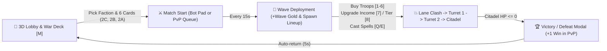

# Epic Battle — Complete Developer Documentation & Architecture Guide

> [!NOTE]
> All source scripts from your offline place copy (`epic_battle.rbxl`) have been unpacked into [`C:/Users/Vince/.gemini/antigravity/scratch/epic_battle/src`](file:///C:/Users/Vince/.gemini/antigravity/scratch/epic_battle/src). You can edit these `.luau` files directly or copy sections into Roblox Studio without affecting your friend's live Team Create session.

---

## 1. Game Overview & Core Loop

**Epic Battle** is a 1v1 lane-based tactical army tug-of-war game (supporting both **1v1 vs AI Bot** and **1v1 Ranked PvP Duels** across up to 12 concurrent arena instances).



### Core Mechanics Summary
| Mechanic | Value / Formula | Source Location |
| :--- | :--- | :--- |
| **Factions** | 6 (`Kingdom`, `Republic`, `Alien`, `Demon`, `Void`, `Mechanica`), 9 units each (54 total) | [`FactionConfig.Order`](file:///C:/Users/Vince/.gemini/antigravity/scratch/epic_battle/src/ReplicatedStorage/FactionConfig.luau#L3) |
| **Deck Loadout** | **6 Cards** per player: **2 C-Tier** (Slots 1–2), **2 B-Tier** (Slots 3–4), **2 A-Tier** (Slots 5–6) | [`validateLoadout`](file:///C:/Users/Vince/.gemini/antigravity/scratch/epic_battle/src/ServerScriptService/GameServer.server.luau#L341-L356) |
| **Wave Interval** | **15 seconds** per wave (`WAVE_INTERVAL = 15`). Buying a unit adds `+1` to `Lineup[slot]`, which spawns **every** wave! | [`spawnSideWave`](file:///C:/Users/Vince/.gemini/antigravity/scratch/epic_battle/src/ServerScriptService/GameServer.server.luau#L1431-L1473) |
| **Starting Gold & Lineup** | **45 Gold**, `Lineup = {1, 0, 0, 0, 0, 0}` (starts with 1 copy of Slot 1 C-tier unit) | [`startMatch`](file:///C:/Users/Vince/.gemini/antigravity/scratch/epic_battle/src/ServerScriptService/GameServer.server.luau#L1511-L1543) |
| **Wave Income (`[7]`)** | `30 * IncomeLevel` Gold per wave (Lv.1 = `30G` ... Lv.5 Max = `150G`). Upgrade costs: `100G`, `120G`, `140G`, `160G` | [`getSideWaveIncome`](file:///C:/Users/Vince/.gemini/antigravity/scratch/epic_battle/src/ServerScriptService/GameServer.server.luau#L471-L482) |
| **Tier Unlocks (`[8]`)** | Starts at Tier 1 (C-Tier). Unlock **B-Tier** = `100G` (`TierUnlock = 2`). Unlock **A-Tier** = `250G` (`TierUnlock = 3`) | [`getSideTierUnlockCost`](file:///C:/Users/Vince/.gemini/antigravity/scratch/epic_battle/src/ServerScriptService/GameServer.server.luau#L485-L494) |
| **Dynamic Troop Pricing** | Every `PriceBucketSize` (default `2`) copies owned of a unit increases its cost by `TierPriceStep` (`C = +2G`, `B = +5G`, `A = +12G`) | [`FactionConfig.GetDynamicCost`](file:///C:/Users/Vince/.gemini/antigravity/scratch/epic_battle/src/ReplicatedStorage/FactionConfig.luau#L29-L41) |
| **Turrets & Citadel** | **Turret 1**: `1500 HP`, `50 DMG`, `36 RNG`, `+100G` Bounty.<br>**Turret 2**: `2500 HP`, `100 DMG`, `28 RNG`, `+200G` Bounty (dormant until Turret 1 dies).<br>**Citadel Base**: `3000 HP` | [`TURRET_CONFIGS`](file:///C:/Users/Vince/.gemini/antigravity/scratch/epic_battle/src/ServerScriptService/GameServer.server.luau#L548-L551) |
| **Commander Spells** | **`[Q]` Strike**: `115 AoE DMG` (radius 23) on nearest enemy cluster (`60s` CD).<br>**`[E]` Support**: `+75 HP` heal & `+45%` speed boost for `6s` to all allied units (`60s` CD) | [`CastSpellEvent`](file:///C:/Users/Vince/.gemini/antigravity/scratch/epic_battle/src/ServerScriptService/GameServer.server.luau#L2087-L2157) |

---

## 2. Project Structure & Hierarchy

### Script Map
| Service / Path in Studio | Extracted File | Size | Responsibility |
| :--- | :--- | :--- | :--- |
| `ReplicatedStorage.FactionConfig` | [FactionConfig.luau](file:///C:/Users/Vince/.gemini/antigravity/scratch/epic_battle/src/ReplicatedStorage/FactionConfig.luau) | ~25 KB | Master configuration for SFX, dynamic pricing, and all 6 factions' units & spells |
| `ReplicatedStorage.RigBuilder` | [RigBuilder.luau](file:///C:/Users/Vince/.gemini/antigravity/scratch/epic_battle/src/ReplicatedStorage/RigBuilder.luau) | ~41 KB | Procedural 3D model generator (`BuildUnitRig`), Mechanica rigs, and CFrame animation solver (`PoseRig`) |
| `ReplicatedStorage.FactionRigs.Kingdom` | [Kingdom.luau](file:///C:/Users/Vince/.gemini/antigravity/scratch/epic_battle/src/ReplicatedStorage/FactionRigs/Kingdom.luau) | ~26 KB | 3D part assembly for Solaris Empire (Gothic plate armor, plumes, staves, hammers) |
| `ReplicatedStorage.FactionRigs.Republic` | [Republic.luau](file:///C:/Users/Vince/.gemini/antigravity/scratch/epic_battle/src/ReplicatedStorage/FactionRigs/Republic.luau) | ~29 KB | 3D part assembly for Aegis Coalition (tactical visors, riot shields, rifles, gatling guns) |
| `ReplicatedStorage.FactionRigs.Alien` | [Alien.luau](file:///C:/Users/Vince/.gemini/antigravity/scratch/epic_battle/src/ReplicatedStorage/FactionRigs/Alien.luau) | ~41 KB | 3D part assembly for Hive Mind (chitin carapaces, bio-plasma cannons, claws) |
| `ReplicatedStorage.FactionRigs.Demon` | [Demon.luau](file:///C:/Users/Vince/.gemini/antigravity/scratch/epic_battle/src/ReplicatedStorage/FactionRigs/Demon.luau) | ~44 KB | 3D part assembly for Hellfire Legion (horns, quadruped Hell Hound, runeblades, wings) |
| `ReplicatedStorage.FactionRigs.Void` | [Void.luau](file:///C:/Users/Vince/.gemini/antigravity/scratch/epic_battle/src/ReplicatedStorage/FactionRigs/Void.luau) | ~64 KB | 3D part assembly for Abyssal Void (hooded wraiths, void scythes, floating monolith orbs) |
| `ServerScriptService.GameServer` | [GameServer.server.luau](file:///C:/Users/Vince/.gemini/antigravity/scratch/epic_battle/src/ServerScriptService/GameServer.server.luau) | ~100 KB | Authoritative server loop: arenas, matchmaking, economy, wave spawning, unit AI, combat, DataStores, admin commands |
| `ServerScriptService.NPCShowcaseService` | [NPCShowcaseService.server.luau](file:///C:/Users/Vince/.gemini/antigravity/scratch/epic_battle/src/ServerScriptService/NPCShowcaseService.server.luau) | ~4 KB | Teleport pads between `Lobby` and `NPCShowcaseRoom` + interactive NPC pedestals |
| `StarterPlayerScripts.ClientController` | [ClientController.client.luau](file:///C:/Users/Vince/.gemini/antigravity/scratch/epic_battle/src/StarterPlayer/StarterPlayerScripts/ClientController.client.luau) | ~92 KB | Pure-Luau UI creation (`BigBattleHUD`), Deck Builder, Bot/PvP modals, Tactical Camera, keybinds, Dev Console |

### Workspace Hierarchy & World Coordinates
* **`Workspace.Lobby`** (Centered around `(0, 11.5, -135)`):
  * `BotStepPad`: Stepping on this opens the **Crucible Bot Trial** modal.
  * `DuelPadWest` & `DuelPadEast`: Stepping on these queues/starts a **1v1 PvP Duel**.
  * `LobbyToShowcasePortal.ShowcasePad`: Teleports player to `Workspace.NPCShowcaseRoom` at `(0, 303, 1390)`.
  * `LeaderboardMonument`: Displays the top 12 commanders by Ranked PvP Wins.
  * `Shrines`: Interactive faction shrines (`Shrine_Kingdom`, `Shrine_Republic`, etc.) with `ProximityPrompt`s.
* **`Workspace.Battlefield` & `Battlefield_2` .. `Battlefield_6`** (Up to 12 Arena Slots):
  * Each arena has `LaneFloor`, `PlayerBase` (West, `OriginX - 107`), `EnemyBase` (East, `OriginX + 107`), `EnvironmentProps`, and invisible `ArenaBarriers`.
  * Each Base model contains `Platform`, `Core` (with `BaseHUD`), `Crystal`, `NorthTower`, `SouthTower`, `Turret1`, and `Turret2`.
* **`Workspace.Units` & `ArenaUnits_2` .. `ArenaUnits_12`**: Runtime folders holding active unit `Model`s per arena.
* **`Workspace.Effects`**: Temporary combat beams, AoE spheres, and positional 3D sound parts (capped at 26 children to prevent clutter).

---

## 3. Data & Balance System (`FactionConfig.luau`)

All unit stats and special mechanics are data-driven via [FactionConfig.luau](file:///C:/Users/Vince/.gemini/antigravity/scratch/epic_battle/src/ReplicatedStorage/FactionConfig.luau). You can give **any** unit in any faction special abilities simply by adding the corresponding property keys to its table in `FactionConfig.Factions[FactionName].Units`:

### Supported Unit Property Keys & Passive Mechanics
| Property Key(s) | Type | What It Does in `GameServer.server.luau` | Example Unit(s) |
| :--- | :--- | :--- | :--- |
| `Id`, `Tier`, `Name`, `Role` | `number`, `string` | Unit index (`1..9`), Tier (`"C"`, `"B"`, `"A"`), display name, and short HUD description | All units |
| `Cost`, `PriceBucketSize` | `number` | Base Gold cost and how many purchases before price steps up (default `2`) | Priest (`Cost = 32, PriceBucketSize = 2`) |
| `HP`, `Damage`, `Range`, `AttackCooldown`, `Speed` | `number` | Core combat stats. `Range <= 7` is melee; `Range >= 15` fires ranged beam VFX | All units |
| `WeaponType`, `SoundType` | `string` | Controls archetype classification and attack sound key in `FactionConfig.SFX` | `"Sword"`, `"Rifle"`, `"Laser"`, `"Heal"` |
| `DamageReduction` | `number` (`0..1`) | Flat percentage damage resistance (e.g., `0.25` = 25% less damage taken). Note: `ShieldTank` archetype gets `0.18` by default | Knight (`0.25`), Riot Shield (`0.25`) |
| `DamageReductionAura` | `number` (`0..1`) | Grants damage reduction to all allied units within 24 studs (`distSq <= 576`) | Elite Riot (`0.15`), Void Warden (`0.20`) |
| `AttackSpeedAura` | `number` (`0..1`) | Multiplies attack speed of all allied units within 24 studs (`1 + AttackSpeedAura`) | Elite Knight (`0.10`), Cybernetic Commander (`0.20`) |
| `FirstStrikeDamage` | `number` | Overrides `Damage` on the unit's very first attack (`AttacksMade == 0`) | Grenade Thrower (`50` on 1st hit, `35` after) |
| `ThirdHitDamage` | `number` | Overrides `Damage` on every 3rd hit (`HitCount % 3 == 0`) with burst VFX | Plasma Specialist (`55`), Plasma Robot (`55`) |
| `FourthHitDamage` | `number` | Overrides `Damage` on every 4th hit (`HitCount % 4 == 0`) with arcane VFX | Kingdom Mage (`45`) |
| `BurstInterval`, `BurstHits`, `BurstDamage` | `number` | Every `BurstInterval` attacks, fires `BurstHits` rapid extra shots dealing `BurstDamage` each | Rifleman (`3` hits of `10` DMG every `3`rd attack) |
| `CloseRangeDamage`, `LongRangeDamage`, `CloseRangeThreshold` | `number` | Deals `CloseRangeDamage` if target distance `<= CloseRangeThreshold` (default `8.5`), else `LongRangeDamage` | Shotgunner (`35` point-blank / `15` ranged) |
| `HealAmount`, `HealInterval`, `HealMaxTargets` | `number` | Every `HealInterval` seconds, heals up to `HealMaxTargets` injured allies within `28` studs | Priest (`20 HP / 3s`), High Priest (`30 HP / 4s`), Medic Bot |
| `ShieldAmount`, `ShieldInterval`, `ShieldRadius` | `number` | Pulses a non-stacking `ShieldAmount` overshield to allies within `ShieldRadius` every `ShieldInterval` seconds | Shield Bot (`30` Shield / `5s`) |
| `EmergencyShieldAmount`, `EmergencyShieldThreshold` | `number` | Once per life, when HP drops to/below `Threshold` (e.g. `0.30` = 30%), clamps HP and grants an instant overshield | Plasma Overlord (`+40` Shield at `<= 30%` HP) |
| `RegenHP`, `RegenInterval` | `number` | Self-heals `RegenHP` every `RegenInterval` seconds | Alien Juggernaut (`+60 HP` every `4.5s`) |
| `ReviveHP` | `number` | Once per life, upon taking fatal damage (`HP <= 0`), revives on the spot with `ReviveHP` | Mutated Warrior (`30 HP` undying revive) |
| `DeathImmunity` | `number` | Once per life, upon taking fatal damage, stays alive at `1 HP` and becomes invulnerable for `DeathImmunity` seconds | Soul Drainer (`1.0s` death immunity) |
| `HealOnHit` / `Lifesteal` | `number` | Restores HP to the attacker on every hit (`HealOnHit` is flat; `Lifesteal < 1` is fraction of damage dealt, `>= 1` is flat) | Blood Knight (`30`), Demon Lord (`50`) |
| `HealOnKill` | `number` | Restores flat HP whenever the unit lands a killing blow on an enemy unit | Soul Reaper (`+10 HP` on kill) |
| `PoisonDPS`, `PoisonDuration` | `number` | Applies a poison Damage-over-Time debuff ticking every `1.0s` | Acid Spitter (`5 DPS` for `4s`) |
| `BurnDPS`, `BurnDuration` | `number` | Applies a burning Damage-over-Time debuff ticking every `1.0s` | Flame Caster (`6 DPS` for `3s`) |
| `SlowFactor`, `SlowDuration` | `number` | Multiplies target movement speed by `SlowFactor` for `SlowDuration` seconds | Supported in [`applyOnHitEffects`](file:///C:/Users/Vince/.gemini/antigravity/scratch/epic_battle/src/ServerScriptService/GameServer.server.luau#L1391-L1394) |
| `AttackDebuff` | `number` (`0..1`) | Permanently reduces damaged enemy's outgoing attack damage by `AttackDebuff` % | Abyss Mage (`0.25` = -25% Enemy ATK) |
| `SummonUnitId`, `SummonCount`, `SummonInterval` | `number` | Every `SummonInterval` seconds, spawns a stacked squad (`StackMult = SummonCount`) of `Units[SummonUnitId]` | Hive Commander (Summons `2` Alien Grunts every `11s`) |

---

## 4. Procedural 3D Rig & Animation System (`RigBuilder.luau`)

To keep framerates high with dozens of active troops across multiple arenas, units **do not use Roblox `Humanoid` instances**. Instead, [RigBuilder.luau](file:///C:/Users/Vince/.gemini/antigravity/scratch/epic_battle/src/ReplicatedStorage/RigBuilder.luau) builds lightweight anchored/welded part hierarchies and animates all active units across all arenas in a single batched `Workspace:BulkMoveTo(FrameBulkParts, FrameBulkCFrames)` call per server `Heartbeat`.

### How `BuildUnitRig` Works
1. **6 Core Limbs**: Every unit starts with 6 anchored `BasePart`s created in [`RigBuilder.BuildUnitRig`](file:///C:/Users/Vince/.gemini/antigravity/scratch/epic_battle/src/ReplicatedStorage/RigBuilder.luau#L130-L188):
   * `"Body"` (`PrimaryPart`), `"Head"`, `"LeftArm"`, `"RightArm"`, `"LeftLeg"`, `"RightLeg"`.
2. **Faction Rig Builders**: `BuildUnitRig` delegates to the faction's module in `ReplicatedStorage.FactionRigs` (or inline for `Mechanica`):
   * Each decorative armor plate, helmet, plume, or weapon is created with `makePart` / `makeWedge` and attached to one of the 6 core limb keys via `attach(limbKey, part, offsetCFrame)`.
   * If a part is named `"Weapon"`, it is automatically used as the origin point for ranged laser/beam effects (`u.Weapon.Position`).
3. **WeldConstraint Optimization**: After posing the initial rig, all decorative attachment parts are unanchored (`Massless = true`) and welded to their parent limb via `WeldConstraint` ([lines 734–761](file:///C:/Users/Vince/.gemini/antigravity/scratch/epic_battle/src/ReplicatedStorage/RigBuilder.luau#L734-L761)). That means during combat, `RigBuilder.PoseRig` only has to move **7 parts per unit** (the 6 core limbs + ground `Ring`)!
4. **11 Visual Archetypes** ([`getUnitArchetype`](file:///C:/Users/Vince/.gemini/antigravity/scratch/epic_battle/src/ReplicatedStorage/RigBuilder.luau#L72-L128)):
   * Controls stance, forward lean, shield holding angle, ranged aiming pitch (`78°`), hover bobbing (`HoverDrone`), or 4-legged canine trotting gait (`Hell Hound`).

---

## 5. Server Engine (`GameServer.server.luau`)

### Multi-Arena Architecture
* By default, 6 themed arenas (`ArenaSlots[1..6]`) are initialized at startup around the map (`FACTION_ARENA_DEFS`), and up to `MAX_ARENA_COUNT = 12` can be dynamically cloned if all 6 are busy ([`createArenaSlot`](file:///C:/Users/Vince/.gemini/antigravity/scratch/epic_battle/src/ServerScriptService/GameServer.server.luau#L711-L772)).
* [`setArenaContext(arena)`](file:///C:/Users/Vince/.gemini/antigravity/scratch/epic_battle/src/ServerScriptService/GameServer.server.luau#L417-L428) switches the module's active pointers (`Battlefield`, `Match`, `ActiveUnits`, `ActiveTurrets`, `PendingWaveSpawns`) so all combat functions operate cleanly on whichever arena is currently being ticked or handled.

### Combat & Targeting Priority (Per Frame in `RunService.Heartbeat`)
For each unit in `ActiveUnits` ([lines 2566–2817](file:///C:/Users/Vince/.gemini/antigravity/scratch/epic_battle/src/ServerScriptService/GameServer.server.luau#L2566-L2817)):
1. **DoT Ticks**: Applies Poison and Burn damage once per second.
2. **Periodic Unit Abilities**: Runs Healer beams, Shield Bot pulses, Alien Juggernaut self-regen, and Hive Commander unit summons.
3. **Throttled Spatial Scan (`refreshUnitCachedScan`)**: Runs every `~0.15s` per unit to find:
   * Nearest enemy unit (`CachedTarget`)
   * Nearest attackable enemy turret (`CachedTurret` — **Turret 2 is ignored while Turret 1 is alive**)
   * Friendly crowd-separation vector (`CachedSepVec`) and friendly auras within 24 studs (`CachedDmgReduction`, `CachedAtkSpeedMult`).
4. **Attack / Movement Decision**:
   * **Priority 1**: If `bestUnitTarget` is within `range`, stop and attack the unit.
   * **Priority 2**: Else if `bestTurretTarget` is within `math.max(range, 7.5)`, stop and attack the turret.
   * **Priority 3**: Else if enemy Citadel Base (`OriginX ± 107`) is within `math.max(range, 8.5)`, stop and attack the Citadel.
   * **Priority 4**: Otherwise, advance down the lane toward the nearest enemy unit/turret/Citadel while blending in `CachedSepVec` so units don't stack on top of each other.

---

## 6. Client UI, Controls & Camera (`ClientController.client.luau`)

All UI is built procedurally in [`ClientController.client.luau`](file:///C:/Users/Vince/.gemini/antigravity/scratch/epic_battle/src/StarterPlayer/StarterPlayerScripts/ClientController.client.luau) inside a single `ScreenGui` named `BigBattleHUD`.

### Player Controls & Hotkeys
| Key / Input | Context | Action |
| :--- | :--- | :--- |
| **`[M]`** | Lobby / Match | In Lobby: Toggle the **6-Card Grimoire Deck Builder & PvP Modal**. In Match: Return to Lobby button |
| **`[1]` – `[6]`** | In Match | Buy troop in Deck Slot `1..6` (adds `+1` to your wave spawn lineup) |
| **`[7]`** | In Match | Upgrade **Wave Gold Income** (Lv.1 → Lv.5 Max) |
| **`[8]`** | In Match | Upgrade **Tier Unlock** (Unlock B-Tier `100G` → Unlock A-Tier `250G`) |
| **`[Q]` / `[E]`** | In Match | Cast Faction Offensive Strike (`Q`) or Support Heal/Speed (`E`) spell |
| **`[V]`** | In Match | Toggle between **Tactical Battlefield Camera** and **3rd-Person Character Camera** |
| **`[F]` / `[X]` / `[Z]` / `[C]`** | In Match | Focus Tactical Camera on: **Player (`F`)**, **Center Clash (`X`)**, **Ally Base (`Z`)**, **Enemy Base (`C`)** |
| **Right-Click Drag / Scroll** | In Match | Pan Tactical Camera along the lane (`X` axis) / Zoom in & out (`18` to `68` studs) |
| **`[F2]`** | Anywhere (Admins) | Toggle the **Developer & Admin Console** modal (always enabled in Studio) |

---

## 7. Network Protocol (`ReplicatedStorage.Remotes`)

| RemoteEvent | Direction | Arguments / Payload | Purpose |
| :--- | :--- | :--- | :--- |
| **`BuyUnit`** | Client → Server | `(slotIdx: number)` (`1..6`) | Purchases 1 troop in the given deck slot for the player's side |
| **`UpgradeStat`** | Client → Server | `(upgradeType: "Income" \| "TierUnlock")` | Upgrades wave income (`[7]`) or unlocks B/A tiers (`[8]`) |
| **`CastSpell`** | Client → Server | `(key: "Q" \| "E")` | Casts the player's faction spell (`60s` cooldown) |
| **`SwitchFaction`** | Client → Server | `(targetSide: "Player" \| "Enemy" \| "Restart", factionName?: string)` | Restarts match or switches faction mid-match |
| **`LobbyAction`** | Both | **C→S**: `("SelectFaction", fName)`, `("SetLoadout", {6 ids})`, `("StartBotMatch", myFaction, botFaction, diff)`, `("LeaveToLobby")`, `("ChallengePlayer", userId)`, `("AcceptChallenge", userId)`, `("JoinPvPQueue")`<br>**S→C**: `("OpenLobbyUI", mode)`, `("OpenBotDifficultyModal")` | Handles all deck building, faction switching, bot match launch, and PvP matchmaking |
| **`ChallengeEvent`** | Server → Client | `("IncomingChallenge", challengerId, challengerName, challengerFaction)` | Displays the 1v1 Duel Challenge accept/decline popup |
| **`StateUpdate`** | Server → Client | `(stateTable)` ([see lines 971–1007](file:///C:/Users/Vince/.gemini/antigravity/scratch/epic_battle/src/ServerScriptService/GameServer.server.luau#L971-L1007)) | Full snapshot of match state, gold, lineup, turret HP, base HP, cooldowns, and lobby player list |
| **`BannerNotice`** | Server → Client | `(msg: string, color: Color3, localSoundType?: string)` | Displays animated top-center announcement text and plays optional local SFX |
| **`MatchResult`** | Server → Client | `(resultData)` ([see lines 1718–1731](file:///C:/Users/Vince/.gemini/antigravity/scratch/epic_battle/src/ServerScriptService/GameServer.server.luau#L1718-L1731)) | Triggers the Victory/Defeat modal and 5-second auto-return countdown |
| **`AdminCommand`** | Client → Server | `(commandStr: string, arg?: any)` | Executes developer commands (`gold`, `tier`, `wave`, `heal`, `wipe`, `killturret`, `win`) |

---

## 8. Developer Cookbooks (How to Build & Modify by Hand)

### Recipe 1: How to Tweak Balance or Add a Custom Unit Passive
1. Open [FactionConfig.luau](file:///C:/Users/Vince/.gemini/antigravity/scratch/epic_battle/src/ReplicatedStorage/FactionConfig.luau).
2. Find the unit inside `FactionConfig.Factions.<Faction>.Units` and edit its stats (`Cost`, `HP`, `Damage`, `Range`, `AttackCooldown`, `Speed`) or add any passive key from **Section 3** above.
3. **Want a brand-new passive mechanic?**
   * Add a custom key to the unit in `FactionConfig.luau` (for example, `CritChance = 0.25, CritMult = 2.0`).
   * In [GameServer.server.luau](file:///C:/Users/Vince/.gemini/antigravity/scratch/epic_battle/src/ServerScriptService/GameServer.server.luau), locate [`getUnitAttackDamage`](file:///C:/Users/Vince/.gemini/antigravity/scratch/epic_battle/src/ServerScriptService/GameServer.server.luau#L1148-L1174) (for damage modifiers), [`applyOnHitEffects`](file:///C:/Users/Vince/.gemini/antigravity/scratch/epic_battle/src/ServerScriptService/GameServer.server.luau#L1381-L1398) (for debuffs), or [`damageUnit`](file:///C:/Users/Vince/.gemini/antigravity/scratch/epic_battle/src/ServerScriptService/GameServer.server.luau#L1265-L1379) (for defensive/on-death triggers) and check `u.Def.CritChance`.

### Recipe 2: How to Edit or Create a 3D Unit Model
1. Open the faction's rig module in `ReplicatedStorage/FactionRigs/` (e.g., [Kingdom.luau](file:///C:/Users/Vince/.gemini/antigravity/scratch/epic_battle/src/ReplicatedStorage/FactionRigs/Kingdom.luau)) — or [RigBuilder.luau](file:///C:/Users/Vince/.gemini/antigravity/scratch/epic_battle/src/ReplicatedStorage/RigBuilder.luau#L288-L645) for `Mechanica`.
2. Inside the `if uName == "YourUnitName" then` branch, use the helper functions:
   ```luau
   -- P(name, sizeVec3, color3, material, partShape) creates a scaled Part
   -- at(limbKey, part, x, y, z, rxDeg, ryDeg, rzDeg) attaches it to a limb
   -- Valid limbKeys: "Head", "Body", "LeftArm", "RightArm", "LeftLeg", "RightLeg"
   -- Note: -Z is FRONT (facing enemy), +Z is BACK, +Y is UP
   at("RightArm", P("Weapon", Vector3.new(0.2, 0.2, 3.2), ROYAL_GOLD, Enum.Material.Neon), 0, -1.0, -1.4)
   ```
3. Always name the main gun/staff/sword part `"Weapon"` so ranged beam effects originate from the weapon's tip.

### Recipe 3: How to Add a Brand-New 7th Faction
1. **[FactionConfig.luau](file:///C:/Users/Vince/.gemini/antigravity/scratch/epic_battle/src/ReplicatedStorage/FactionConfig.luau)**:
   * Append your new faction key to `FactionConfig.Order` (line 3).
   * Add `FactionConfig.Factions.YourFaction = { DisplayName = "...", Badge = "...", Subtitle = "...", MainColor = ..., AccentColor = ..., Units = { 9 units (3 C, 3 B, 3 A) }, Spells = { Q = {...}, E = {...} } }`.
2. **`ReplicatedStorage.FactionRigs`**:
   * Create a new `ModuleScript` `ReplicatedStorage.FactionRigs.YourFaction` with `YourFactionRig.build(ctx)` and add an `elseif factionName == "YourFaction" then` branch in [`RigBuilder.BuildUnitRig`](file:///C:/Users/Vince/.gemini/antigravity/scratch/epic_battle/src/ReplicatedStorage/RigBuilder.luau#L203-L288).
3. **UI Automatically Adapts**:
   * Both the Lobby Deck Builder tabs and the Crucible Bot Faction selector loop over `FactionConfig.Order` dynamically (`fColWidth = 1 / #FactionConfig.Order`), so your 7th faction will appear in the UI automatically!

### Recipe 4: Using Built-In Admin Commands for Fast Testing
While testing in Roblox Studio (or as the game creator), press **`[F2]`** to open the **Developer & Admin Console**, or type in chat:
* `/gold 5000` — Grants `+5000` Gold in your current match
* `/tier 3` — Unlocks all C, B, and A-Tier slots immediately
* `/wave` — Skips the 15-second timer and deploys the next wave immediately
* `/heal` — Restores your Citadel Base to `3000 HP`
* `/wipe` — Destroys all active enemy units on the battlefield
* `/killturret 1` or `/killturret 2` — Destroys the enemy's Turret 1 or Turret 2
* `/win` — Triggers instant match victory
